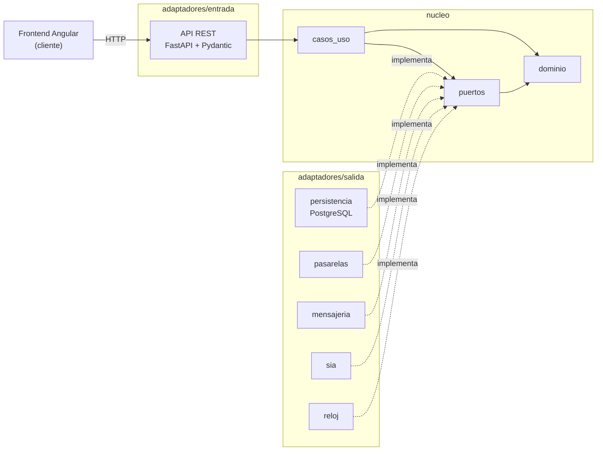

# ADR-001: Estilo arquitectónico del sistema de boletería

- Estado: Propuesto | Fecha: 27/11/2026 | Autor: Sergio Velásquez

Relacionados: [vision.md](../vision.md), [drivers.md](../drivers.md), [ADR-002](ADR-002-backend.md) (backend), [ADR-003](ADR-003-frontend.md) (frontend), [ADR-004](ADR-004-base-de-datos.md) (base de datos), [ADR-005](ADR-005-integracion-pasarelas-mensajeria.md) (integración), [ADR-006](ADR-006-persistencia.md) (persistencia), [ADR-007](ADR-007-reloj-como-puerto.md) (reloj) y la [vista de desarrollo](../vistas/03-desarrollo.md), que fija los nombres de carpetas y archivos. Según el enunciado, este ADR queda **propuesto** en la semana 0 y se **acepta** en la iteración 1, después de la clase de arquitectura hexagonal (RT-01).

## Contexto

La universidad quiere vender boletas en línea y cobrar por medios electrónicos, y deja libre la elección de la pasarela de pago y del servicio de mensajería, que pueden cambiar en el futuro (OB-03). El enunciado convierte esto en exigencias que no se negocian:

- El estilo es hexagonal o Clean Architecture, justificado frente a los drivers (RT-01).
- El núcleo (dominio y casos de uso) no depende de frameworks, base de datos, web ni proveedores y se comunica solo por puertos (RT-02).
- La pasarela y la mensajería se cambian por configuración, sin que ningún archivo del núcleo cambie en Git (RT-05, EAC-01, EAC-02).
- El tiempo es un puerto con reloj del sistema y reloj controlable (RT-04, EAC-04).
- La persistencia es relacional (RT-03); el equipo eligió PostgreSQL ([ADR-004](ADR-004-base-de-datos.md)).

Fuerzas que tensionan la decisión:

- **Muchos sistemas externos para un núcleo pequeño.** El núcleo habla con cuatro sistemas que deben poder reemplazarse o simularse: pasarela, mensajería, SIA y reloj, además de la base de datos. El riesgo principal no está en la complejidad del dominio sino en sus fronteras (PA-01, PA-03, PA-04).
- **Poco tiempo y pocas personas.** 3 personas y dos iteraciones de una semana (RT-10, R-01). Cada capa extra es código y revisión adicional.
- **Un agente de IA escribe buena parte del código.** Las decisiones de arquitectura no se delegan y todo se revisa a mano (RT-08). Cuantas más capas y reglas, más fácil que el agente ponga código en el lugar equivocado y más difícil revisarlo (R-02).
- **La regla de dependencia se evalúa en el código** (30 % de la nota): debe poder verificarse de forma simple en cada pull request (RT-02, RT-09).

## Drivers relacionados

| ID | Por qué pesa |
|---|---|
| OB-03, RT-05 | Cambiar pasarela o mensajería sin tocar el núcleo es la razón de ser de la exigencia arquitectónica |
| EAC-01 | Cambiar la pasarela: 0 archivos de código editados entre pasarelas existentes; 0 archivos del núcleo al integrar una nueva |
| EAC-02 | Lo mismo para la mensajería |
| RT-02, R-02 | Regla de dependencia verificable: ningún archivo del núcleo importa un adaptador, FastAPI, Pydantic ni SQLAlchemy |
| RT-04, EAC-04 | El reloj debe ser un puerto con dos adaptadores para demostrar vencimiento y cierre sin esperar |
| RT-03, PA-02 | La persistencia en PostgreSQL va detrás de repositorios; la protección del cupo (EAC-03) vive en el adaptador sin filtrar SQL al núcleo |
| RT-10, R-01 | 3 personas, 2 semanas de construcción |
| RT-08, R-02 | El agente debe respetar la estructura; menos capas, menos lugares donde equivocarse |
| PA-01 | Preocupación de estructura general que este ADR resuelve |

## Alternativas consideradas

### A1. Arquitectura hexagonal (puertos y adaptadores)

**Descripción.** La aplicación es un núcleo rodeado de puertos. Los **puertos de entrada** expresan lo que el núcleo ofrece (los casos de uso); los **puertos de salida** expresan lo que necesita del exterior (repositorios, pago, notificación, SIA, reloj). Los **adaptadores** implementan o usan esos puertos: la API REST conduce al núcleo; PostgreSQL, las pasarelas, la mensajería, el SIA y el reloj son conducidos por él. Solo hay una frontera relevante: dentro o fuera del núcleo.

**Ventajas.**
- Su modelo es el problema de este sistema: intercambiar sistemas externos. Cada sistema externo es un puerto con uno o varios adaptadores, y los simulados del enunciado son adaptadores más.
- Su vocabulario (núcleo, puerto, adaptador) es el que usa el enunciado en sus definiciones.
- Una sola frontera hace que la regla de dependencia sea fácil de verificar: nada en `nucleo/` importa nada de `adaptadores/` ni de librerías externas.
- Pocas carpetas y pocos tipos de componentes: menos código repetitivo y menos lugares donde el agente puede equivocarse.

**Desventajas.**
- No prescribe cómo organizar el interior del núcleo: el equipo debe definir la separación entre dominio y casos de uso.
- No define dónde se ensamblan los adaptadores (raíz de composición); hay que decidirlo.
- Si el dominio creciera mucho, una sola frontera podría quedarse corta; no es el caso de este alcance.

### A2. Clean Architecture

**Descripción.** Círculos concéntricos: entidades, casos de uso, adaptadores de interfaz (controladores, presentadores, gateways) y frameworks y drivers. Las dependencias apuntan siempre hacia adentro. Cada caso de uso suele definir su frontera de entrada, su modelo de petición y su modelo de respuesta, y un presentador adapta la salida.

**Ventajas.**
- Separa de forma explícita entidades y casos de uso, con reglas claras para cada círculo.
- Escala bien a dominios grandes y a varios mecanismos de entrega.
- La regla de dependencia es igual de estricta; el enunciado acepta los términos puerto y adaptador para este estilo también.

**Desventajas.**
- Más capas y más tipos de componentes por caso de uso (frontera de entrada, modelos de petición y respuesta, presentador, controlador): más archivos para 12 casos de uso en 2 semanas.
- Hay que verificar la dependencia entre cuatro círculos, no solo entre núcleo y exterior.
- Con FastAPI y Angular, los presentadores duplican lo que ya hacen los esquemas de Pydantic y el cliente Angular.
- Más reglas de ubicación para que el agente de IA las respete y para que el revisor las compruebe.

## Comparación

Efecto sobre el driver: **+** lo favorece, **0** neutro o lo permite con trabajo adicional, **−** lo dificulta.

| Driver | A1. Hexagonal | A2. Clean Architecture |
|---|---|---|
| EAC-01 cambiar pasarela sin tocar el núcleo | **+** La pasarela es un puerto de salida con un adaptador por proveedor; el `.env` elige cuál | **+** La pasarela es un gateway en la capa de adaptadores de interfaz; el efecto es el mismo |
| EAC-02 cambiar mensajería sin tocar el núcleo | **+** Igual que la pasarela | **+** Igual que la pasarela |
| RT-02 regla de dependencia verificable | **+** Una frontera: `nucleo/` no importa `adaptadores/` ni librerías externas; se comprueba con una búsqueda de imports | **0** Es igual de estricta, pero hay que comprobar cuatro círculos y la dirección entre cada par |
| RT-04 reloj como puerto | **+** Puerto de salida con adaptadores `sistema` y `controlable` | **+** Gateway con las mismas dos implementaciones |
| RT-03 PostgreSQL detrás de repositorios | **+** Repositorios como puertos de salida; SQLAlchemy y el bloqueo de filas solo en el adaptador | **+** Repositorios como gateways; mismo resultado |
| RT-10, R-01 3 personas, 2 semanas | **+** Tres carpetas principales (núcleo, adaptadores de entrada, adaptadores de salida) | **−** Frontera de entrada, modelos de petición y respuesta y presentador por caso de uso: más archivos y más revisión |
| RT-08, R-02 el agente respeta la estructura | **+** Pocas reglas de ubicación, fáciles de escribir en `AGENTS.md` y de revisar | **−** Más capas donde el agente puede poner lógica en el lugar equivocado (por ejemplo, reglas en el presentador o en el controlador) |
| PA-01 vocabulario compartido con el enunciado | **+** Núcleo, puerto, adaptador y simulado son los términos del enunciado | **0** El enunciado acepta los términos, pero el estilo usa otros (gateway, presentador, frontera) |

**Lectura.** En los drivers técnicos de intercambio (EAC-01, EAC-02, RT-04, RT-03) las dos alternativas empatan: ambas aíslan el núcleo con interfaces. La diferencia está en el costo: hexagonal logra lo mismo con menos capas (RT-10, R-01), con reglas más fáciles de verificar (RT-02) y de transmitir al agente (RT-08, R-02).

## Decisión

Se propone **arquitectura hexagonal** (puertos y adaptadores).

Razones:

1. El problema central del sistema es intercambiar sistemas externos (pasarela, mensajería, SIA y reloj), y hexagonal está construida alrededor de esa idea: cada sistema externo es un puerto y cada proveedor o simulado es un adaptador (OB-03, EAC-01, EAC-02, RT-04).
2. Su vocabulario es el del enunciado, lo que hace que la documentación, el código y la revisión hablen el mismo idioma (PA-01).
3. Logra el mismo aislamiento que Clean Architecture con menos capas, lo que encaja con 3 personas, 2 semanas y un agente de IA que debe respetar la estructura (RT-10, R-01, RT-08, R-02).

### Estructura

```text
src/
├── backend/
│   ├── nucleo/
│   │   ├── dominio/          # entidades y reglas de negocio (RN-01 a RN-11)
│   │   ├── casos_uso/        # un caso de uso por CU del catálogo (puertos de entrada)
│   │   └── puertos/          # puertos de salida: interfaces que el núcleo necesita
│   ├── adaptadores/
│   │   ├── entrada/          # API REST con FastAPI y Pydantic
│   │   └── salida/
│   │       ├── persistencia/ # PostgreSQL con SQLAlchemy y Alembic
│   │       ├── pasarelas/    # simulada_a, simulada_b
│   │       ├── mensajeria/   # consola, archivo
│   │       ├── sia/          # simulado
│   │       ├── reloj/        # sistema, controlable
│   │       └── qr/           # imagen del QR con la librería qrcode
│   ├── scripts/              # script de datos de demostración
│   └── arranque.py           # raíz de composición: lee el .env y conecta puertos y adaptadores
└── frontend/                 # Angular: cliente del adaptador de entrada
```

Los valores de los adaptadores son los de las variables del `.env` documentadas en el [README](../../README.md#configuración-de-adaptadores) (`PASARELA_PAGO`, `MENSAJERIA`, `SIA`, `RELOJ`).

### Reglas de dependencia

- `nucleo/dominio/` no depende de nada fuera de sí mismo.
- `nucleo/casos_uso/` depende de `dominio/` y de `puertos/`.
- `nucleo/puertos/` depende solo de `dominio/`.
- `adaptadores/` depende de `nucleo/`; nunca al revés.
- Nada en `nucleo/` importa `adaptadores/`, `fastapi`, `pydantic`, `sqlalchemy`, librerías de proveedores ni lee la hora del sistema: el tiempo llega por el puerto Reloj ([estandares.md](../equipo/estandares.md)).
- Angular no es parte del backend: es un cliente que solo habla con el adaptador de entrada por HTTP ([ADR-003](ADR-003-frontend.md)).



## Consecuencias

**Positivas**
- Cambiar de pasarela o de mensajería es agregar un adaptador en `adaptadores/salida/` y cambiar una variable del `.env`; `git diff --name-only -- src/backend/nucleo` queda vacío (EAC-01, EAC-02).
- La regla de dependencia se verifica con una búsqueda de imports en `src/backend/nucleo/`, una línea de la lista de verificación de revisión (RT-02, RT-09).
- El reloj controlable es un adaptador más: la demostración del vencimiento y del cierre no requiere esperar (EAC-04).
- El núcleo se puede ejecutar y revisar sin levantar FastAPI ni PostgreSQL.
- Las reglas de ubicación caben en pocas líneas de `AGENTS.md`.

**Negativas**
- Hexagonal no dice cómo dividir el núcleo; la división `dominio/`, `casos_uso/`, `puertos/` es una decisión del equipo y debe mantenerse con disciplina.
- Hay que traducir entre los esquemas de Pydantic y las clases del dominio, y entre los modelos de SQLAlchemy y el dominio ([ADR-002](ADR-002-backend.md), [ADR-004](ADR-004-base-de-datos.md)).
- Ningún mecanismo del lenguaje impide un import prohibido: depende de la revisión.

**Riesgos aceptados**
- Que la clase de arquitectura hexagonal muestre una variante distinta (por ejemplo, puertos de entrada explícitos o carpetas por caso de uso) y haya que ajustar la vista de desarrollo (R-09). Se acepta porque el cambio sería de organización dentro del núcleo, no de la frontera.
- Que, sin las capas de Clean, la lógica de negocio se filtre a los adaptadores (por ejemplo, el cálculo del descuento en el adaptador del SIA o el bloqueo del doble pago en la API). Se mitiga con la regla de [ADR-003](ADR-003-frontend.md) y [estandares.md](../equipo/estandares.md): toda regla de negocio vive en el núcleo, y el revisor lo comprueba en cada pull request.

## Qué debe confirmarse tras la clase de arquitectura hexagonal

| # | Qué confirmar | Opción propuesta |
|---|---|---|
| 1 | ¿Los puertos de entrada son interfaces explícitas o los casos de uso son el puerto de entrada? | Los casos de uso son el puerto de entrada; `puertos/` contiene solo los de salida |
| 2 | ¿`puertos/` se divide en `entrada/` y `salida/`? | Depende de la respuesta 1 |
| 3 | Dónde vive la raíz de composición que lee el `.env` y ensambla los adaptadores | Fuera del núcleo y de `adaptadores/`, en `src/backend/arranque.py` (resuelto en la [vista de desarrollo](../vistas/03-desarrollo.md)) |
| 4 | Cómo se verifica la regla de dependencia | Búsqueda de imports en la lista de verificación de revisión; evaluar una herramienta que la compruebe en cada pull request |
| 5 | Dónde se genera la imagen QR (PA-09) | En un adaptador de salida (`adaptadores/salida/qr/`) detrás del puerto `GeneradorQR`, para no meter la librería en el núcleo (resuelto en la vista de desarrollo) |
| 6 | Si la decisión se mantiene | Pasar este ADR a **Aceptado** y completar la vista de desarrollo; si cambia, escribir un ADR nuevo que lo reemplace y ajustar la vista |
