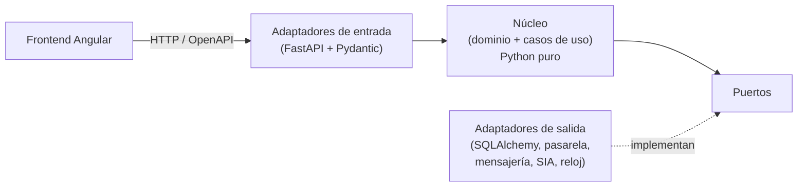

# ADR-002: Tecnología del backend

| Campo | Valor |
|---|---|
| Estado | Aceptado |
| Autora | Mariana García |
| Fecha | 27/11/2026 |
| Aprobación de arquitectura | Sergio Velásquez (gerente de desarrollo) [NECESITA ACLARACIÓN: según `normas.md` en arquitectura decide Sergio; ¿Sergio ya aprobó esta decisión para dejarla en estado Aceptado?] |
| Relacionados | [ADR-001](ADR-001-estilo-arquitectonico.md) (estilo hexagonal), `vision.md` (RT-02, RT-05, RT-07) |

## 1. Contexto

El enunciado permite cualquier tecnología para el backend, pero exige que cada elección se justifique en un ADR frente a los drivers del proyecto, y aclara que no basta con decir que el equipo ya la conoce (RT-07).

El backend debe cumplir lo siguiente:

- Alojar el núcleo (dominio y casos de uso) sin dependencias de frameworks, base de datos, web ni proveedores (RT-02), según el estilo hexagonal propuesto en el ADR-001.
- Exponer una API REST que consuma la interfaz web de administración y de usuario (RT-06).
- Conectar la pasarela de pago, la mensajería, el SIA y el reloj como adaptadores elegidos por configuración, sin tocar el núcleo (RT-04, RT-05, OB-03).
- Persistir en una base de datos relacional con transacciones, para que no se venda por encima del cupo con compras simultáneas (RT-03, OB-01, R-03). La elección de la base de datos y de la estrategia de integridad se justifica en el ADR de persistencia.
- Generar la imagen del código QR de cada boleta (OB-02).
- Entregarse en el plazo del enunciado (v0.1 el 04/12/2026 y v1.0 el 11/12/2026) con 3 personas (R-01).

## 2. Drivers de decisión

| ID local | Driver | Origen |
|---|---|---|
| C1 | Núcleo como clases puras, sin anotaciones ni imports del framework (regla de dependencia) | RT-02, OB-03, R-02 |
| C2 | Facilidad para conectar adaptadores según el `.env` | RT-05, OB-03 |
| C3 | API REST con documentación OpenAPI automática que Angular pueda consumir | RT-06 |
| C4 | Acceso a PostgreSQL con transacciones (SQLAlchemy en la alternativa elegida) | RT-03, OB-01, R-03 |
| C5 | Generación de QR con la librería `qrcode` o su equivalente | OB-02 |
| C6 | Calidad del código que produce el agente de IA (SDD) | RT-08, R-02 |
| C7 | Plazo de 2 semanas con 3 personas | RT-10, R-01 |

*Los ID C1 a C7 son locales a este ADR. Cuando exista `drivers.md`, deben reemplazarse por los ID de ese catálogo [NECESITA ACLARACIÓN: ¿qué ID tendrán estos drivers en `drivers.md`?].*

## 3. Alternativas consideradas

### A1. Python 3.12 + FastAPI

API REST sobre ASGI. Los esquemas de entrada y salida se declaran con Pydantic y FastAPI genera la documentación OpenAPI a partir de ellos. La inyección de dependencias es opcional y se limita a los endpoints.

### A2. Java 21 + Spring Boot

Framework con inyección de dependencias por anotaciones (`@Service`, `@Component`, `@Autowired`) y un ecosistema amplio para web, datos y seguridad.

### A3. TypeScript + NestJS

Framework con inyección de dependencias por decoradores (`@Injectable`, `@Controller`) y un mismo lenguaje que el frontend en Angular.

## 4. Comparación

Escala: **Alto** = favorece el driver; **Medio** = lo permite con disciplina o con trabajo adicional; **Bajo** = va en contra del driver. Es una valoración del equipo para este proyecto, no una medición.

| Driver | A1. Python + FastAPI | A2. Java 21 + Spring Boot | A3. TypeScript + NestJS |
|---|---|---|---|
| C1. Núcleo puro | **Alto.** Las clases del núcleo son Python común (dataclasses y protocolos o clases abstractas para los puertos). FastAPI y Pydantic se usan solo en la capa de entrada | **Medio.** Es posible con clases sin anotaciones y con el ensamblado en una clase de configuración, pero el estilo habitual del framework anota los servicios, lo que empuja a importar `org.springframework` en los casos de uso | **Medio.** Los casos de uso se vuelven proveedores con `@Injectable()`, es decir, con imports de `@nestjs/common` en el núcleo, salvo que se ensamblen a mano fuera de la inyección del framework |
| C2. Adaptadores según `.env` | **Alto.** Una función de ensamblado (raíz de composición) lee las variables y construye el adaptador elegido; no requiere contenedor de inyección | **Alto.** Perfiles y `@ConditionalOnProperty` permiten elegir el adaptador, pero ata la selección al framework | **Alto.** Los módulos dinámicos y `ConfigModule` permiten elegir el proveedor, pero ata la selección al framework |
| C3. REST + OpenAPI para Angular | **Alto.** El documento OpenAPI y la interfaz de pruebas se generan sin configurar nada adicional a partir de los esquemas de los endpoints | **Medio.** Requiere la librería `springdoc-openapi` y anotaciones para describir los endpoints | **Medio.** Requiere `@nestjs/swagger`, con decoradores o su plugin para describir los DTO |
| C4. PostgreSQL con transacciones | **Alto.** SQLAlchemy 2 con transacciones explícitas, bloqueo de filas (`with_for_update`) y restricciones; Alembic para migraciones, ambos solo en adaptadores | **Alto.** JPA/Hibernate con transacciones y bloqueo pesimista u optimista | **Medio.** TypeORM o Prisma cubren transacciones, pero el bloqueo a nivel de fila exige más cuidado según la librería |
| C5. QR | **Alto.** `qrcode` genera la imagen en pocas líneas | **Medio.** Se usa una librería como ZXing, con más código para producir la imagen | **Alto.** Existe un paquete `qrcode` con la misma función |
| C6. Calidad del código del agente | **Medio.** Código breve y legible que el equipo puede revisar rápido; los tipos son opcionales, por lo que se exige `mypy` o `pyright` para detectar errores [NECESITA ACLARACIÓN: ¿el equipo adopta un verificador de tipos? El enunciado no pide pruebas automatizadas, pero no prohíbe esta herramienta] | **Alto en tipado, medio en volumen.** El tipado estático detecta errores, pero el código es más extenso y el agente tiende a ceñirse a las anotaciones del framework | **Medio.** Tipado estático, pero con los decoradores del framework el agente tiende a mezclar el núcleo con ellos |
| C7. Plazo de 2 semanas, 3 personas | **Alto.** Poco código repetitivo y arranque rápido sin compilación | **Medio.** Más código repetitivo y configuración, con un ciclo de compilación | **Medio.** Estructura de módulos que añade código repetitivo para un alcance pequeño |

### Argumentos por alternativa

- **A1** cumple los siete drivers sin trabajo adicional relevante. Su punto débil es el tipado opcional (C6), que se mitiga con una herramienta de verificación de tipos.
- **A2** es sólida en transacciones (C4) y en tipado, pero el costo en C1, C3 y C7 es mayor para un alcance de 2 semanas.
- **A3** comparte lenguaje con Angular, lo que simplifica el trabajo del equipo con una sola tecnología. Ese beneficio no está ligado a ningún driver del backend: la API es REST y el contrato lo da OpenAPI, así que no se pondera como driver. Frente a C1 y C3 queda por debajo de A1.

## 5. Decisión

El backend se construirá en **Python 3.12 + FastAPI**.

Razones, ligadas a los drivers:

1. **C1 y RT-02:** el núcleo se escribe como clases de Python común, sin decoradores, anotaciones ni base de datos. FastAPI y Pydantic quedan confinados a los adaptadores de entrada, de modo que el framework no tiene punto de entrada al núcleo ni por convención.
2. **C2 y RT-05:** el ensamblado de adaptadores es una función que lee el `.env` y construye la pasarela, la mensajería, el SIA y el reloj elegidos. Cambiar de proveedor es agregar un adaptador y editar la configuración, sin tocar el núcleo (OB-03).
3. **C3 y RT-06:** FastAPI genera el documento OpenAPI y la documentación interactiva desde los esquemas de los endpoints sin configuración adicional, y de ahí se puede generar el cliente de Angular.
4. **C4 y OB-01:** SQLAlchemy ofrece transacciones y bloqueo de filas en PostgreSQL, que son las herramientas con las que el ADR de persistencia protegerá el cupo con compras simultáneas (R-03). SQLAlchemy y Alembic se usan solo en adaptadores.
5. **C5:** `qrcode` genera la imagen de la boleta sin código adicional relevante.
6. **C6 y C7:** el código es breve, lo que facilita la revisión humana de lo que produce el agente (RT-08) y reduce el volumen de código repetitivo en un plazo de 2 semanas (R-01).
7. **Factor adicional, no único:** el equipo conoce Python [NECESITA ACLARACIÓN: ¿cuántos integrantes ya han usado Python y FastAPI? Este dato no está en el enunciado ni en `vision.md`]. Reduce el riesgo en C7, pero la decisión se sostiene sin él por las razones 1 a 6.

## 6. Consecuencias

**Regla que se registra:**

- **FastAPI y Pydantic solo se usan en los adaptadores de entrada. El núcleo no los importa.** Los modelos de Pydantic son esquemas de la API; el dominio usa sus propias clases y los adaptadores de entrada traducen entre ambos.

**Positivas:**

- El núcleo se puede ejecutar y revisar sin levantar el servidor web ni la base de datos.
- La documentación OpenAPI se mantiene al día porque se genera del código.
- El cambio de pasarela o de mensajería no toca el núcleo.

**Negativas y mitigaciones:**

| Consecuencia | Mitigación |
|---|---|
| Hay que escribir la traducción entre esquemas Pydantic y clases del dominio, con duplicación de estructuras | Es el costo de la regla de dependencia (RT-02); se acepta |
| El tipado de Python es opcional y los errores de tipo pueden llegar a ejecución | Verificador de tipos en la revisión de PR [NECESITA ACLARACIÓN: ver C6] |
| Ningún mecanismo del framework impide importar FastAPI o Pydantic desde el núcleo | Lista de verificación de revisión de código y revisión del PR por alguien distinto del autor (R-02, `normas.md`); `AGENTS.md` repite la regla en cada sesión con el agente |
| Python no tiene un contenedor de inyección de dependencias estándar | El ensamblado se hace a mano en una raíz de composición; se limita al `.env` y a una función |
| Este ADR no decide la base de datos ni la estrategia contra la sobreventa | Se resuelven en el ADR de persistencia |
