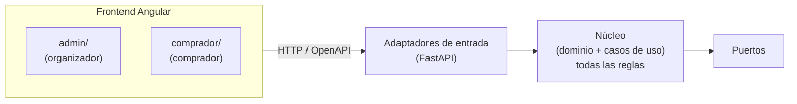

# ADR-003: Tecnología del frontend

| Campo | Valor |
|---|---|
| Estado | Aceptado |
| Autor | Bairon Vásquez |
| Fecha | 27/11/2026 |
| Aprobación de arquitectura | Sergio Velásquez (gerente de desarrollo), aprobado |
| Relacionados | [ADR-001](ADR-001-estilo-arquitectonico.md) (estilo hexagonal), [ADR-002](ADR-002-backend.md) (API REST con FastAPI y OpenAPI), `vision.md` (RT-02, RT-06, RT-07, RT-11, OB-02, R-01) |

## 1. Contexto

El enunciado exige una interfaz web con pantallas para la parte de administración (organizador) y la de usuario (comprador), ambas conectadas al mismo núcleo; una API sola no basta y el diseño visual no se evalúa (RT-06). Como toda elección tecnológica, la del frontend debe justificarse en un ADR frente a los drivers, sin bastar con que el equipo ya la conozca (RT-07).

En el estilo hexagonal del [ADR-001](ADR-001-estilo-arquitectonico.md), el frontend es parte de un **adaptador de entrada**: traduce lo que hace el usuario en llamadas al núcleo y muestra sus resultados. No contiene reglas de negocio (RT-02).

El frontend debe cumplir lo siguiente:

- Ofrecer las pantallas de administración y de comprador, con la imagen QR de cada boleta (OB-02).
- Mantener separadas las dos partes del producto.
- Consumir la API REST del backend, cuyo contrato documenta FastAPI con OpenAPI ([ADR-002](ADR-002-backend.md)).
- Poder instalarse y ejecutarse desde cero siguiendo el README (RT-11).
- Entregarse en el plazo del enunciado con 3 personas (R-01).

## 2. Drivers de decisión

| ID local | Driver | Origen |
|---|---|---|
| C1 | Pantallas web para administración y comprador; el diseño visual no se evalúa | RT-06, OB-02 |
| C2 | El frontend es un adaptador de entrada y no contiene reglas de negocio | RT-02, [ADR-001](ADR-001-estilo-arquitectonico.md) |
| C3 | Separación en módulos `admin/` y `comprador/` | RT-06 |
| C4 | Consumo de la API: CORS y contrato de endpoints | [ADR-002](ADR-002-backend.md) (C3), RT-06 |
| C5 | Mostrar la imagen del código QR de la boleta | OB-02 |
| C6 | Instalación desde cero con el README (Node y Angular CLI en versiones fijas) | RT-11 |

El conocimiento previo del equipo se registra como **factor adicional** (fila C7 de la comparación y punto 7 de la decisión). No es un driver y no decide por sí solo.

*Los ID C1 a C6 son locales a este ADR: [drivers.md](../drivers.md) ya existe y no incluye estos criterios [NECESITA ACLARACIÓN: ¿se incorporan a `drivers.md` o se mantienen locales a cada ADR?].*

## 3. Alternativas consideradas

### A1. Angular (SPA que consume la API REST de FastAPI)

Aplicación de una sola página en TypeScript, en un proyecto aparte del backend. Incluye enrutamiento con carga diferida, formularios, cliente HTTP y CLI para generar la estructura. Se comunica con el backend solo por HTTP.

### A2. Plantillas renderizadas en el servidor con Jinja2

Las pantallas son plantillas HTML que el propio FastAPI renderiza, dentro del mismo proyecto Python y sin Node. No hay un cliente que consuma la API REST.

### A3. React

Biblioteca de interfaces en JavaScript o TypeScript, también como SPA en un proyecto aparte. No incluye enrutamiento, formularios ni cliente HTTP: el equipo los elige y los integra.

## 4. Comparación

Escala: **Alto** = favorece el driver; **Medio** = lo permite con disciplina o con trabajo adicional; **Bajo** = va en contra del driver. Es una valoración del equipo para este proyecto, no una medición.

| Driver | A1. Angular | A2. Jinja2 en el servidor | A3. React |
|---|---|---|---|
| C1. Pantallas de ambas partes | **Alto.** Componentes, formularios reactivos y rutas cubren las pantallas de cartelera, reserva, pago y gestión de eventos | **Alto.** Formularios HTML renderizados por el servidor cubren las mismas pantallas con menos código | **Alto.** Cubre las pantallas, pero exige elegir bibliotecas de rutas y formularios |
| C2. Adaptador sin reglas de negocio | **Alto.** El frontend es otro proceso: no puede importar el núcleo y todo pasa por HTTP, así que las reglas viven solo en el backend | **Medio.** Las plantillas se ejecutan en el mismo proceso y proyecto que los casos de uso. Aceptan expresiones y objetos de Python, lo que invita a poner lógica en la plantilla o a llamar al núcleo desde ella | **Alto.** Igual que Angular: otro proceso, solo HTTP |
| C3. Módulos `admin/` y `comprador/` | **Alto.** Dos rutas raíz con carga diferida (`loadChildren`) y una estructura de carpetas que propone la CLI | **Medio.** Se separa con carpetas de plantillas y routers de FastAPI, por convención y sin una herramienta que la imponga | **Medio.** Se separa con carpetas y rutas por convención; el equipo debe definir la estructura |
| C4. Consumo de la API (CORS y contrato) | **Alto.** `HttpClient` tipado, proxy de desarrollo (`proxy.conf.json`) que evita CORS al desarrollar, y cliente generable desde el OpenAPI. En ejecución normal el backend necesita CORS para el origen del frontend | **Medio.** No hay CORS porque comparten origen, pero nadie consume el contrato OpenAPI: la API REST que el [ADR-002](ADR-002-backend.md) documenta queda sin consumidor | **Alto.** Equivale a Angular, pero el cliente HTTP y el manejo de estado del servidor son decisiones adicionales |
| C5. Imagen del QR | **Alto.** Una etiqueta `img` con la URL del endpoint o con una imagen incrustada (data URL) | **Alto.** Igual: la plantilla incluye la etiqueta `img` | **Alto.** Igual que Angular |
| C6. Instalación desde cero con el README | **Medio.** Segundo proyecto con Node `<versión>` y Angular CLI `<versión>` [NECESITA ACLARACIÓN: ¿qué versiones de Node y de Angular CLI se fijan? El enunciado no las define y no las fijé por el equipo] | **Alto.** Sin Node: `jinja2` es una dependencia más del backend y se instala con un solo gestor | **Medio.** Segundo proyecto con Node `<versión>` y su gestor de paquetes; no requiere CLI global, pero sí un empaquetador |
| C7. Conocimiento del equipo (factor, no driver) | Dato pendiente [NECESITA ACLARACIÓN: ¿cuántos integrantes han usado Angular?] | Dato pendiente [NECESITA ACLARACIÓN: ¿cuántos han usado Jinja2?] | Dato pendiente [NECESITA ACLARACIÓN: ¿cuántos han usado React?] |

### Argumentos por alternativa

- **A1** cumple C2, C3 y C4 con las herramientas que trae. Su costo es C6: un segundo proyecto con Node y Angular CLI.
- **A2** es la más simple de instalar y de construir (C1, C6), pero deja la lógica de presentación dentro del proceso del núcleo (C2) y no consume la API REST del [ADR-002](ADR-002-backend.md) (C4). La separación entre el núcleo y su adaptador de entrada pasa a depender de la disciplina del equipo.
- **A3** cumple C2 y C4 igual que A1. Pierde frente a A1 en C3 y en el trabajo de integración: el equipo debe elegir y mantener el enrutamiento, los formularios y el cliente HTTP (R-01).

## 5. Decisión

El frontend se construirá en **Angular**, como SPA que consume la API REST de FastAPI.

Razones, ligadas a los drivers:

1. **C2 y RT-02:** el frontend es un proceso aparte y solo habla con el backend por HTTP. No puede importar el núcleo, y las reglas (cupo, descuentos, límites) se aplican únicamente en el backend. Con Jinja2 esa frontera dependería de la disciplina del equipo.
2. **C3 y RT-06:** `admin/` y `comprador/` son dos rutas raíz con carga diferida, y la CLI impone la estructura de carpetas. La separación de las dos partes del producto queda en la herramienta y no solo en una convención.
3. **C4:** Angular consume el contrato OpenAPI que genera FastAPI ([ADR-002](ADR-002-backend.md), C3). `HttpClient` y los tipos de TypeScript permiten reflejar los endpoints en el frontend, y el proxy de desarrollo evita CORS al programar.
4. **C1 y C5:** las tres alternativas cubren las pantallas y el QR, por lo que estos drivers no desempatan. Como el diseño visual no se evalúa (RT-06), no se añade una biblioteca de componentes visuales.
5. **Angular frente a React:** Angular trae enrutamiento, formularios y cliente HTTP. Con 3 personas y 2 semanas (R-01), esto evita decisiones de bibliotecas que React deja abiertas.
6. **Costo aceptado:** Jinja2 gana en C6, porque instalar un solo proyecto es más simple. El equipo acepta el costo de un segundo proyecto a cambio de C2, C3 y C4, y lo mitiga con el README (sección 6).
7. **Factor adicional, no único:** el equipo conoce Angular [NECESITA ACLARACIÓN: ¿cuántos integrantes ya han usado Angular? Este dato no está en el enunciado ni en `vision.md`]. Reduce el riesgo de plazo, pero la decisión se sostiene sin él por las razones 1 a 6.

## 6. Consecuencias

**Reglas que se registran:**

- **El frontend Angular no contiene reglas de negocio.** Toda regla (cupo disponible, descuentos por tipo de público, máximo de 4 boletas por evento, plazo de la reserva) se valida en el núcleo, aunque Angular también la muestre para orientar al usuario. Si Angular y el núcleo discrepan, vale el núcleo.
- **El frontend solo se comunica con el backend por la API REST.** No hay acceso directo a la base de datos ni a los sistemas externos.

**Positivas:**

- La frontera HTTP hace que ninguna regla de negocio pueda esconderse en el frontend por importación.
- El contrato OpenAPI es el punto de acuerdo entre el backend y el frontend, y se mantiene al día porque se genera del código.
- Las dos partes del producto se desarrollan y revisan por separado.

**Negativas y mitigaciones:**

| Consecuencia | Mitigación |
|---|---|
| Hay dos proyectos que instalar y ejecutar: backend (Python y base de datos) y frontend (Node) | El README documenta los pasos de ambos y las versiones de Node y Angular CLI; Bairon mantiene el README (`roles.md`) |
| La API debe documentar sus endpoints, porque el frontend depende de ese contrato | Cada endpoint declara sus esquemas de entrada, de salida y de error con los modelos de FastAPI (OpenAPI); un endpoint sin documentar no se integra |
| Si Angular y el núcleo validan lo mismo, las reglas pueden divergir | El núcleo es la única autoridad; el frontend muestra los errores que devuelve la API y no los reinterpreta. La lista de verificación de revisión incluye "ninguna regla nueva en `src/frontend`" |
| El frontend se sirve desde un origen distinto del backend y requiere CORS | El backend permite el origen del frontend en el adaptador de entrada, configurado en el `.env`; en desarrollo se usa el proxy de Angular |
| Este ADR no decide cómo se autentica el organizador en `admin/` | Se decide en un ADR aparte (S-03, `vision.md`) |
| Este ADR no define el formato en que la API entrega la imagen del QR (URL del endpoint o imagen incrustada) | Se define con el contrato de endpoints, en la especificación del caso de uso correspondiente |
