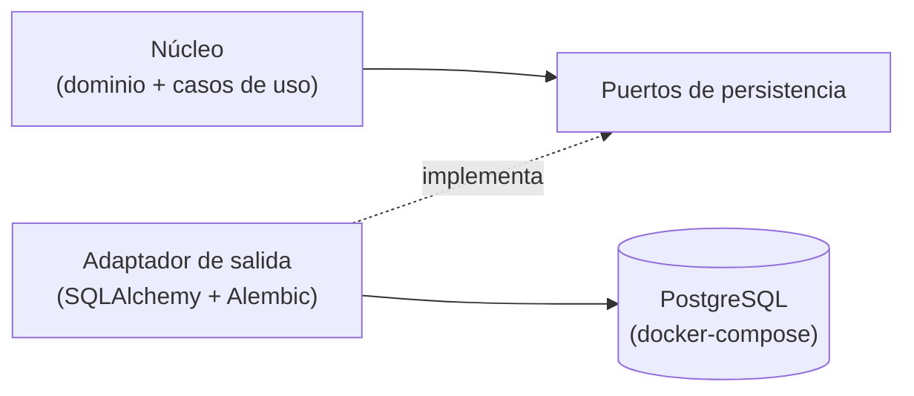

# ADR-004: Base de datos

| Campo | Valor |
|---|---|
| Estado | Aceptado |
| Autora | Mariana García |
| Fecha | 27/11/2026 |
| Aprobación de arquitectura | Sergio Velásquez (gerente de desarrollo) [NECESITA ACLARACIÓN: según `normas.md` en arquitectura decide Sergio; ¿ya aprobó esta decisión para dejarla en estado Aceptado?] |
| Relacionados | [ADR-001](ADR-001-estilo-arquitectonico.md) (estilo hexagonal), [ADR-002](ADR-002-backend.md) (backend con SQLAlchemy), [ADR-006](ADR-006-persistencia.md) (persistencia y estrategia de integridad), `vision.md` (RT-02, RT-03, RT-07, OB-01, R-03) |

## 1. Contexto

El enunciado exige una base de datos relacional y que la elección se justifique en un ADR frente a los drivers del proyecto, sin bastar con que el equipo ya la conozca (RT-03, RT-07).

El sistema necesita lo siguiente:

- Que ninguna reserva ni venta supere el cupo disponible (aforo menos boletas pagadas y reservas vigentes), aunque varios compradores compitan por el último cupo (OB-01, S-02, R-03).
- Que el pago, la emisión de las boletas y el reembolso queden consistentes: no puede haber una boleta emitida sin pago confirmado ni un pago confirmado sin boletas o sin reembolso (OB-02, OB-04).
- Que quien clone el repositorio pueda instalar y ejecutar el sistema desde cero siguiendo el README (RT-11).
- Que funcione con SQLAlchemy y Alembic, que el [ADR-002](ADR-002-backend.md) confina a los adaptadores (RT-02).
- Que no tenga costo, por tratarse de un proyecto universitario.

Este ADR elige el motor. Cómo se protege el cupo con ese motor (bloqueos, restricciones, aislamiento) se decide en el [ADR-006](ADR-006-persistencia.md).

## 2. Drivers de decisión

| ID local | Driver | Origen |
|---|---|---|
| C1 | Integridad del cupo con reservas simultáneas: bloqueo por fila (`SELECT ... FOR UPDATE`) en lugar de bloquear toda la base | OB-01, S-02, R-03 |
| C2 | Transacciones ACID para pago, emisión de boletas y reembolso | OB-01, OB-02, OB-04, R-04 |
| C3 | Instalación desde cero con Docker, documentada en el README | RT-11 |
| C4 | Soporte de SQLAlchemy y Alembic | [ADR-002](ADR-002-backend.md), RT-03 |
| C5 | Costo cero | Restricción del proyecto universitario [NECESITA ACLARACIÓN: el enunciado no habla de costo; ¿el costo cero es una restricción del docente o solo del equipo?] |

*Los ID C1 a C5 son locales a este ADR: [drivers.md](../drivers.md) ya existe y no incluye estos criterios [NECESITA ACLARACIÓN: ¿se incorporan a `drivers.md` o se mantienen locales a cada ADR?].*

## 3. Alternativas consideradas

### A1. PostgreSQL

Base de datos relacional de código abierto con control de concurrencia multiversión (MVCC), bloqueo por fila, transacciones ACID y DDL transaccional.

### A2. MySQL / MariaDB

Bases relacionales de código abierto, con el motor InnoDB para transacciones ACID y bloqueo por fila. Se evalúan juntas porque para este proyecto se comportan de forma equivalente.

### A3. SQLite

Base relacional embebida: un archivo local, sin servidor. Soporta transacciones ACID, pero las escrituras bloquean toda la base de datos.

## 4. Comparación

Escala: **Alto** = favorece el driver; **Medio** = lo permite con límites o trabajo adicional; **Bajo** = va en contra del driver. Es una valoración del equipo para este proyecto, no una medición.

| Driver | A1. PostgreSQL | A2. MySQL / MariaDB | A3. SQLite |
|---|---|---|---|
| C1. Integridad del cupo con simultaneidad | **Alto.** `SELECT ... FOR UPDATE` bloquea solo las filas de la localidad que se está reservando; las compras de otras localidades o eventos no esperan | **Alto.** InnoDB soporta `SELECT ... FOR UPDATE` con bloqueo por fila | **Bajo.** No soporta `SELECT ... FOR UPDATE`: una escritura bloquea toda la base. Evita la sobreventa por serialización total, pero las compras de otras localidades esperan, y bajo competencia el segundo escritor puede fallar con un error de base bloqueada que el adaptador tendría que reintentar |
| C2. Transacciones ACID | **Alto.** Transacciones ACID completas, con DDL transaccional: una migración de Alembic que falla se revierte entera | **Alto en datos, medio en migraciones.** InnoDB es ACID, pero las instrucciones DDL confirman la transacción de forma implícita, así que una migración que falla a la mitad puede dejar el esquema a medias | **Medio.** Es ACID, pero con un solo escritor a la vez: sirve para la consistencia y limita el paralelismo |
| C3. Instalación con Docker desde el README | **Alto.** Imagen oficial; se define en un `docker-compose.yml` con volumen y variables | **Alto.** Imagen oficial con el mismo esquema | **Alto.** No necesita contenedor: es un archivo. Es la opción más simple de instalar, pero no sirve para demostrar C1 |
| C4. SQLAlchemy y Alembic | **Alto.** Dialecto de primera línea; `with_for_update` y migraciones transaccionales | **Alto.** Dialecto soportado; `with_for_update` disponible | **Medio.** Soportado, pero `with_for_update` no tiene efecto y Alembic no puede alterar columnas con `ALTER` en todos los casos, lo que obliga a modo de migración por lotes |
| C5. Costo cero | **Alto.** Licencia de código abierto | **Alto.** Edición comunitaria de código abierto | **Alto.** Dominio público |

### Argumentos por alternativa

- **A1** cumple los cinco drivers. Su costo es operar un servidor, que `docker-compose` reduce a un comando.
- **A2** cumple C1 y C2 en datos. Pierde frente a A1 porque el DDL no es transaccional, lo que debilita las migraciones de Alembic (C2, C4), y no aporta una ventaja propia para este proyecto.
- **A3** gana en C3 por simplicidad, pero no soporta el bloqueo por fila que define C1, y el proyecto debe demostrar que no hay sobreventa con compras simultáneas (OB-01). El volumen de demostración (S-01) haría suficiente a SQLite en tamaño, pero no en concurrencia, y la simultaneidad es precisamente lo que el enunciado pide demostrar.

## 5. Decisión

La base de datos será **PostgreSQL** [NECESITA ACLARACIÓN: ¿qué versión mayor se fija? El enunciado no la define y no la fijé por el equipo], ejecutada con **docker-compose**.

Razones, ligadas a los drivers:

1. **C1 y OB-01:** `SELECT ... FOR UPDATE` bloquea solo las filas de la localidad que se reserva, de modo que la integridad del cupo se logra sin serializar toda la base. Es el mecanismo sobre el que el [ADR-006](ADR-006-persistencia.md) protege el cupo con compras simultáneas (R-03).
2. **C2:** las transacciones ACID mantienen consistentes el pago, la emisión de las boletas y el reembolso, y el DDL transaccional hace que las migraciones de Alembic se apliquen completas o no se apliquen.
3. **C3:** una definición en `docker-compose.yml` levanta la base con un comando, lo que cumple el README de instalación desde cero (RT-11).
4. **C4:** SQLAlchemy y Alembic soportan PostgreSQL de forma nativa y se usan solo en adaptadores, según el ADR-002.
5. **C5:** es de código abierto y no tiene costo.
6. **Factor adicional, no único:** el equipo conoce PostgreSQL [NECESITA ACLARACIÓN: ¿cuántos integrantes ya han usado PostgreSQL? Este dato no está en el enunciado ni en `vision.md`]. La decisión se sostiene sin él por las razones 1 a 5.

## 6. Consecuencias

**Regla que se registra:**

- **SQLAlchemy, Alembic y el controlador de PostgreSQL solo se usan en los adaptadores de salida de persistencia. El núcleo no los importa** (RT-02). El núcleo habla con la base solo por puertos.

**Positivas:**

- El bloqueo por fila permite proteger el cupo sin serializar las compras de otras localidades.
- Las migraciones fallidas se revierten completas.
- Quien clone el repositorio solo necesita Docker para tener la base lista.

**Negativas y mitigaciones:**

| Consecuencia | Mitigación |
|---|---|
| Instalar el sistema requiere Docker, más pesado que un archivo SQLite | El README documenta `docker-compose` como paso de instalación; Bairon mantiene el README y el `.env` (`roles.md`) |
| La conexión a la base se configura en el `.env` | La variable `DATABASE_URL` con la URL de conexión; la lee `arranque.py`, la raíz de composición ([ADR-002](ADR-002-backend.md), [ADR-005](ADR-005-integracion-pasarelas-mensajeria.md)), y el adaptador de persistencia la recibe |
| Cambiar de motor en el futuro implica reescribir consultas específicas de PostgreSQL | Esas consultas viven solo en el adaptador de persistencia; el núcleo no cambia |
| Este ADR no define cómo se aplica el bloqueo, el nivel de aislamiento ni las restricciones de integridad | Se definen en el [ADR-006](ADR-006-persistencia.md) |
| El enunciado pide demostrar la ausencia de sobreventa con compras simultáneas | El escenario de concurrencia se registra en `validacion.md` (R-03) |
