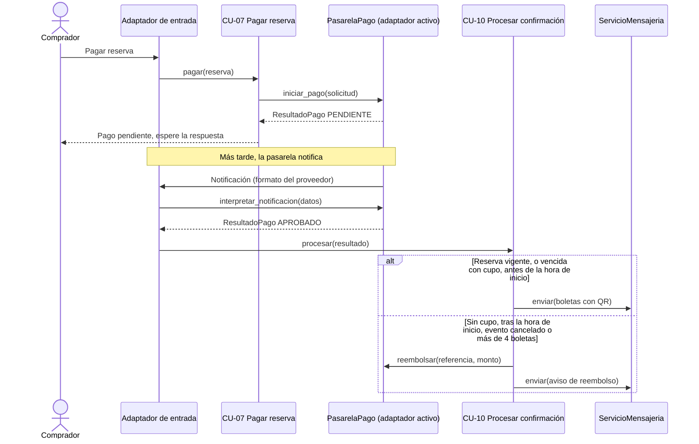

# ADR-005: Modelo de integración con la pasarela de pago, la mensajería y el SIA

- Estado: Aceptado | Fecha: 27/11/2026 | Autor: Sergio Velásquez

Relacionados: [ADR-001](ADR-001-estilo-arquitectonico.md) (estilo hexagonal, propuesto), [ADR-002](ADR-002-backend.md) (FastAPI), [drivers.md](../drivers.md) (PA-03, PA-04), [README](../../README.md#configuración-de-adaptadores) (variables del `.env`). Este es el ADR del "modelo de integración con las pasarelas" que exige el enunciado.

## Contexto

La universidad deja libre la elección de la pasarela de pago y del servicio de mensajería, y ambos pueden cambiar (OB-03). El enunciado exige que el cambio se haga por configuración y que ningún archivo del dominio ni de los casos de uso cambie en Git (RT-05). El SIA se integra con el mismo modelo, aunque el enunciado no exige poder cambiarlo.

Fuerzas:

- **El pago no es una llamada simple.** Tiene tres resultados (aprobado, rechazado, pendiente). Un pago pendiente se confirma después, quizá con la reserva ya vencida, después de la hora de inicio o con el evento cancelado (RN-06, RN-07, S-11, S-12). Hay reembolsos automáticos por el mismo medio de pago (RN-07, RN-10, S-09).
- **Los sistemas son simulados** (S-06), pero deben comportarse como los reales en lo que importa: resultados distintos, confirmación posterior y reembolso.
- **El SIA puede no responder** y el caso de uso debe seguir con la tarifa de público general (S-05, EAC-06).
- **Plazo y agente de IA:** la solución debe ser simple de construir en 2 semanas (R-01) y fácil de revisar (RT-08, R-02).

## Drivers relacionados

| ID | Por qué pesa |
|---|---|
| OB-03, RT-05 | El cambio de pasarela o mensajería no toca el núcleo; entre adaptadores existentes, solo el `.env` |
| EAC-01 | Cambiar la pasarela: 0 archivos de código entre pasarelas existentes; 0 archivos del núcleo al integrar una nueva |
| EAC-02 | Lo mismo para la mensajería |
| EAC-05, R-04 | Pago pendiente, confirmación tardía y reembolso sin doble pago |
| EAC-06, S-05 | El SIA no disponible no detiene la compra |
| RT-02 | Ningún SDK ni librería de proveedor dentro del núcleo |
| PA-03, PA-04 | Preocupaciones de fallas de integración y de configuración de adaptadores |
| RT-10, R-01, RT-08, R-02 | 3 personas, 2 semanas, código del agente revisado a mano |

## Alternativas consideradas

### A1. Llamar al SDK del proveedor desde los casos de uso

**Descripción.** El caso de uso de pago importa la librería del proveedor y la llama directamente; lo mismo para la mensajería y el SIA.

**Ventajas.** Es lo más rápido de escribir para un único proveedor. No hay interfaces que mantener.

**Desventajas.** Viola la regla de dependencia (RT-02). Cambiar de proveedor obliga a editar los casos de uso, que es justo lo que prohíbe RT-05. No hay forma de usar los simulados sin `if` dentro del núcleo.

### A2. Puertos en el núcleo con un adaptador por proveedor, elegido por configuración

**Descripción.** El núcleo define una interfaz por cada sistema externo (puerto) en términos del dominio. Cada proveedor o simulado es un adaptador que la implementa. Al arrancar, el sistema lee el `.env` y conecta cada puerto con el adaptador elegido.

**Ventajas.** El núcleo no conoce a ningún proveedor. Cambiar de proveedor es cambiar una variable; integrar uno nuevo es agregar un adaptador. Es la forma directa de aplicar el estilo hexagonal (ADR-001). Las interfaces son pocas y explícitas, fáciles de revisar.

**Desventajas.** Hay que traducir entre el formato de cada proveedor y los tipos del dominio en cada adaptador. El puerto debe diseñarse bien desde el inicio: si le falta una operación (por ejemplo, reembolsar), agregarla sí toca el núcleo.

### A3. Eventos de dominio con suscriptores

**Descripción.** El núcleo publica eventos (pago solicitado, pago aprobado, evento cancelado) en un bus; los adaptadores de pasarela y mensajería se suscriben y reaccionan.

**Ventajas.** Desacopla mucho a la mensajería, que solo reacciona a hechos. Permite agregar suscriptores (por ejemplo, otro canal de notificación) sin tocar quien publica.

**Desventajas.** El pago necesita una respuesta inmediata (aprobado, rechazado o pendiente) para que el comprador sepa qué pasó: con eventos hay que reconstruir esa petición y respuesta. Requiere un bus, aunque sea en memoria, y manejo de errores de los suscriptores. El flujo es más difícil de seguir en una revisión y en un diagrama de secuencia, y en una demostración. Sigue necesitando puertos para la pasarela.

## Comparación

Efecto sobre el driver: **+** lo favorece, **0** neutro o lo permite con trabajo adicional, **−** lo dificulta.

| Driver | A1. SDK en casos de uso | A2. Puertos y adaptadores por configuración | A3. Eventos de dominio |
|---|---|---|---|
| EAC-01 cambiar pasarela | **−** Hay que editar los casos de uso | **+** Variable `PASARELA_PAGO` del `.env` | **0** Se cambia el suscriptor, pero la respuesta síncrona del pago queda forzada |
| EAC-02 cambiar mensajería | **−** Hay que editar los casos de uso | **+** Variable `MENSAJERIA` del `.env` | **+** Se cambia el suscriptor; es el mejor caso de este modelo |
| RT-02 regla de dependencia | **−** El SDK entra al núcleo | **+** El núcleo solo ve sus puertos | **+** El núcleo solo publica eventos |
| EAC-05 pendiente, tardía, reembolso | **0** Posible, pero mezclado con el SDK | **+** Resultado modelado en el dominio; reembolso como operación del puerto | **0** Posible, con estados repartidos entre eventos y suscriptores |
| EAC-06 SIA no disponible | **0** El caso de uso maneja errores del SDK | **+** El puerto lanza una excepción de dominio; el caso de uso aplica S-05 | **0** La consulta al SIA es petición y respuesta: no encaja en eventos |
| PA-04 configuración | **−** No hay punto de configuración | **+** Un solo punto: `arranque.py` | **0** Hay que configurar el bus y los suscriptores |
| RT-10, R-01 plazo | **+** Lo más corto para un proveedor | **+** Pocas interfaces y un archivo de arranque | **−** Bus, eventos y suscriptores adicionales |
| RT-08, R-02 revisión del código del agente | **−** El agente mezcla SDK y reglas | **+** Interfaces explícitas, fáciles de verificar | **−** Flujo indirecto, difícil de seguir |

## Decisión

Se adopta **A2: puertos en el núcleo con un adaptador por proveedor, elegido por configuración.**

### Puertos

En `src/backend/nucleo/puertos/`, como clases abstractas o `Protocol` de Python [NECESITA ACLARACIÓN: ¿clases abstractas o `Protocol`? Se recomienda clase abstracta (`abc.ABC`): un adaptador al que le falta un método falla al instanciarse, lo que ayuda a revisar el código del agente]. Los nombres de métodos son ilustrativos; se fijan en la vista de desarrollo.

| Puerto | Operaciones | Usado por |
|---|---|---|
| `PasarelaPago` | `iniciar_pago(solicitud) -> ResultadoPago`<br/>`interpretar_notificacion(datos) -> ResultadoPago`<br/>`reembolsar(referencia, monto) -> ResultadoReembolso` | CU-07, CU-10, CU-04 |
| `ServicioMensajeria` | `enviar(notificacion) -> None` | CU-08, CU-10, CU-04 |
| `ConsultaSIA` | `consultar_tipo_publico(documento) -> TipoPublico` | CU-06 |

Los tipos (`SolicitudPago`, `ResultadoPago`, `ResultadoReembolso`, `Notificacion`, `TipoPublico`) son clases del dominio, sin nada de los proveedores.

### Adaptadores

| Puerto | Adaptador | Valor en `.env` | Comportamiento simulado |
|---|---|---|---|
| `PasarelaPago` | `PasarelaSimuladaA` | `PASARELA_PAGO=simulada_a` | Responde según un archivo de respuestas por documento del comprador de prueba (aprobado, rechazado o pendiente); su referencia de pago empieza por `A-` |
| `PasarelaPago` | `PasarelaSimuladaB` | `PASARELA_PAGO=simulada_b` | Igual, con referencias que empiezan por `B-` y su propio archivo de respuestas |
| `ServicioMensajeria` | `MensajeriaConsola` | `MENSAJERIA=consola` | Escribe la notificación en la consola |
| `ServicioMensajeria` | `MensajeriaArchivo` | `MENSAJERIA=archivo` | Escribe la notificación en un archivo de registro |
| `ConsultaSIA` | `SIASimulado` | `SIA=simulado` | Lee estudiantes y egresados del archivo JSON de `SIA_DATOS` |

Cada adaptador escribe al arrancar una línea de registro con su nombre (por ejemplo, "Pasarela activa: simulada_a"). Así se ve qué pasarela está activa en la demostración del README, y lo confirma el prefijo de la referencia de pago. Que las respuestas se definan por documento del comprador es una propuesta del equipo para poder demostrar los tres resultados con el script de datos.

### Ensamblado en `arranque.py`

`arranque.py` [NECESITA ACLARACIÓN: ¿en qué carpeta? Es el punto 3 pendiente del ADR-001; se propone `src/backend/arranque.py`, fuera de `nucleo/` y de `adaptadores/`] lee `PASARELA_PAGO`, `MENSAJERIA` y `SIA` del `.env` y conecta cada puerto con su adaptador mediante un registro por puerto:

```python
PASARELAS = {
    "simulada_a": PasarelaSimuladaA,
    "simulada_b": PasarelaSimuladaB,
}
```

- Si la variable falta o su valor no está en el registro, el backend **no arranca** y muestra los valores válidos (PA-04).
- La inyección de dependencias de FastAPI (`Depends`) se usa **solo en el adaptador de entrada**, para entregar a cada endpoint el caso de uso ya construido. El núcleo no la conoce.

### Resultado del pago

`ResultadoPago` tiene un `estado` (`APROBADO`, `RECHAZADO`, `PENDIENTE`), la `referencia` del pago en la pasarela y un `motivo` opcional. El núcleo guarda cada intento de pago con su estado y referencia, asociado a la reserva.

| Estado | Qué hace el núcleo |
|---|---|
| `APROBADO` | Confirma la reserva y emite las boletas (CU-08) |
| `RECHAZADO` | La reserva sigue vigente; el comprador puede reintentar dentro del plazo (RN-06) |
| `PENDIENTE` | Guarda el pago como pendiente; CU-07 rechaza un nuevo intento sobre la misma reserva mientras exista un pago pendiente (RN-06). El plazo de 10 minutos sigue corriendo (RN-05) |

### Confirmación posterior de un pago pendiente

Se compararon dos mecanismos:

| Mecanismo | A favor | En contra |
|---|---|---|
| **Endpoint de notificación** (simula el webhook de una pasarela real) | Es como funcionan las pasarelas reales; en la demostración se dispara a mano desde la documentación OpenAPI, en el momento que se quiera, también después del vencimiento | Requiere validar que la notificación corresponde a un pago conocido |
| **Consulta periódica** a la pasarela | No requiere exponer un endpoint | Necesita una tarea periódica; el momento de la confirmación no se controla en la demostración |

**Decisión para este punto: endpoint de notificación** [NECESITA ACLARACIÓN: el equipo dejó este punto abierto; ¿se confirma el endpoint de notificación?].

- El adaptador de entrada expone un único endpoint de notificaciones de pago. Recibe los datos en el formato de la pasarela y se los pasa a `PasarelaPago.interpretar_notificacion`, del adaptador activo, que los traduce a un `ResultadoPago`. Así, el formato de cada proveedor queda en su adaptador y el endpoint no cambia al agregar una pasarela.
- Con el `ResultadoPago`, el endpoint llama a CU-10, que aplica RN-07, RN-11, S-11 y S-12 con la hora del puerto Reloj.
- La notificación es **idempotente**: si llega dos veces, o llega para un pago que ya no está pendiente, CU-10 no hace nada.



### Reembolso

El núcleo pide el reembolso con `PasarelaPago.reembolsar(referencia, monto)` sobre la referencia del pago aprobado, que es "el mismo medio de pago" (RN-10, S-09). Lo hacen:

- CU-10, en la confirmación tardía sin cupo, después de la hora de inicio, con el evento cancelado (S-11) o si el comprador superaría 4 boletas (S-12).
- CU-04, al cancelar un evento, por cada boleta pagada.

Tras el reembolso, el núcleo notifica al comprador por `ServicioMensajeria`. El enunciado no dice qué hacer si el reembolso falla; los simulados siempre lo aprueban y el caso queda registrado como deuda técnica DT-01 en `arquitectura.md` [NECESITA ACLARACIÓN: ¿qué debe pasar si la pasarela rechaza un reembolso?].

### SIA no disponible

Si el SIA no responde o no encuentra el documento, el adaptador lanza una excepción de dominio y CU-06 aplica la tarifa de público general con aviso al comprador antes de pagar (S-05, provisional).

### Procedimiento para agregar una pasarela nueva

| Paso | Archivo | Acción |
|---|---|---|
| 1 | `src/backend/adaptadores/salida/pasarelas/<nueva>.py` | **Se crea.** Clase que implementa `PasarelaPago`: `iniciar_pago`, `interpretar_notificacion` y `reembolsar`, traduciendo entre el proveedor y los tipos del dominio |
| 2 | `arranque.py` | **Se modifica una línea:** se agrega la entrada `"<nueva>": PasarelaNueva` al registro de pasarelas |
| 3 | `.env.example` y tabla de variables del README | Se documenta el nuevo valor válido de `PASARELA_PAGO` (documentación, no código) |
| 4 | `.env` (no versionado) | `PASARELA_PAGO=<nueva>` y reinicio del backend |

**No se tocan:**
- Todo `src/backend/nucleo/`: `dominio/`, `casos_uso/` y `puertos/`.
- El adaptador de entrada, incluido el endpoint de notificaciones.
- Los demás adaptadores y el frontend.

**Verificación:** `git diff --name-only main -- src/backend/nucleo` debe quedar vacío (EAC-01). Para la mensajería el procedimiento es el mismo, en `adaptadores/salida/mensajeria/` y con el registro de mensajería de `arranque.py` (EAC-02).

## Consecuencias

**Positivas**
- Cambiar entre adaptadores existentes es editar una variable del `.env`: 0 archivos de código (EAC-01, EAC-02).
- Integrar un proveedor nuevo no toca el núcleo: un archivo nuevo y una línea en `arranque.py`.
- El formato de cada proveedor, incluida su notificación, queda encerrado en su adaptador.
- Los tres resultados del pago, la confirmación tardía y el reembolso se demuestran con los simulados y el reloj controlable, sin esperar (EAC-04, EAC-05).

**Negativas**
- Integrar un proveedor nuevo edita una línea de `arranque.py`. Está fuera del núcleo y el enunciado lo permite ("agregando adaptadores y modificando la configuración"), pero no es configuración pura.
- Si un proveedor necesita una operación que el puerto no tiene, hay que cambiar el puerto, y eso sí toca el núcleo.
- El endpoint de notificaciones está expuesto; con los simulados no se valida su origen.

**Riesgos aceptados**
- Que una pasarela real necesite algo que los simulados no muestran (firma de las notificaciones, montos en otra unidad). Se acepta porque la integración real está fuera de alcance (S-06); la validación del origen quedaría en su adaptador.
- Que el reembolso falle sin un manejo definido (DT-01).

## Qué debe confirmarse tras la clase de arquitectura hexagonal

| # | Qué confirmar | Opción propuesta |
|---|---|---|
| 1 | Puertos como clase abstracta o `Protocol` | Clase abstracta (`abc.ABC`) |
| 2 | Carpeta de `arranque.py` (punto 3 del ADR-001) | `src/backend/arranque.py` |
| 3 | Confirmación de pagos pendientes | Endpoint de notificación que simula el webhook |
| 4 | Si el registro de adaptadores se mantiene en `arranque.py` o se carga por nombre desde el `.env`, para que integrar un proveedor no edite ningún archivo existente | Registro en `arranque.py`: es más simple de revisar |
| 5 | Si este ADR sigue válido en caso de que ADR-001 cambie a Clean Architecture | Sí: los puertos pasan a ser gateways y el resto se mantiene |
