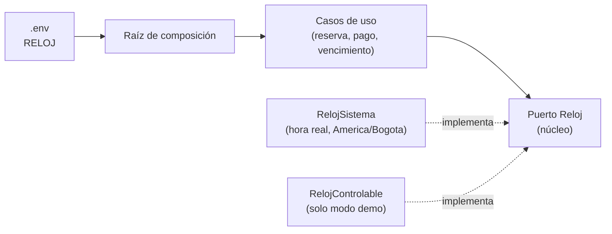
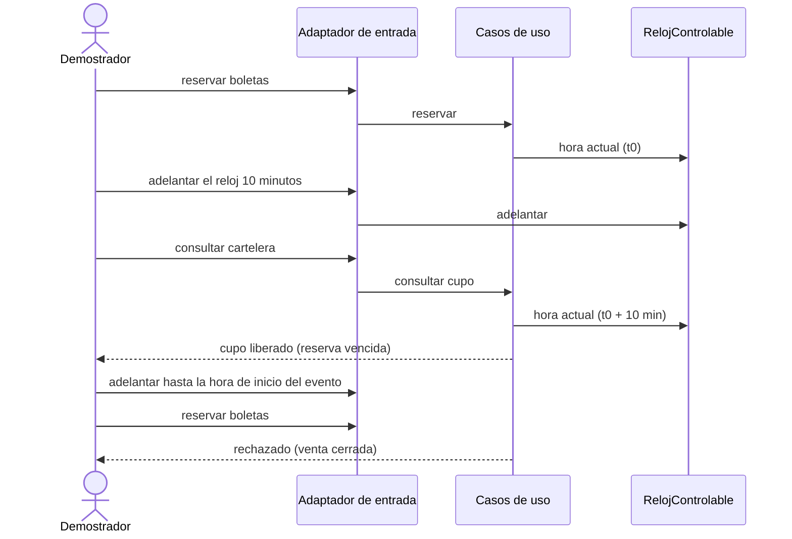

# ADR-007: El reloj como puerto

| Campo | Valor |
|---|---|
| Estado | Aceptado |
| Autor | Bairon Vásquez |
| Fecha | 27/11/2026 |
| Aprobación de arquitectura | Sergio Velásquez (gerente de desarrollo) [NECESITA ACLARACIÓN: según `normas.md` en arquitectura decide Sergio; ¿ya aprobó esta decisión para dejarla en estado Aceptado?] |
| Relacionados | [ADR-001](ADR-001-estilo-arquitectonico.md) (estilo hexagonal), [ADR-002](ADR-002-backend.md) (backend), `vision.md` (RT-02, RT-04, S-14, OB-04, R-04), `drivers.md` (EAC-04, PA-04, PA-07, CU-09), issue TEC-03 |

## 1. Contexto

El enunciado exige que **el tiempo sea un puerto**: un reloj del sistema y un reloj controlable, para demostrar el vencimiento de las reservas y el cierre de la venta sin esperar (RT-04).

Dos reglas de negocio dependen de la hora:

- **Vencimiento (RN-05):** una reserva dura 10 minutos y, si el pago no se confirma en ese plazo, vence y libera el cupo.
- **Cierre de la venta (RN-11):** desde la hora de inicio del evento no se aceptan reservas nuevas ni pagos.

También dependen de la hora la confirmación tardía (RN-07, CU-10) y el vencimiento de reservas por el reloj (CU-09). Todas se evalúan en hora de America/Bogota (S-14).

Si el núcleo leyera la hora del sistema, demostrar estas reglas obligaría a esperar 10 minutos reales o a llegar a la hora de inicio de un evento. Además, la hora sería una dependencia oculta del núcleo, contra la regla de dependencia (RT-02).

## 2. Drivers de decisión

| ID local | Driver | Origen |
|---|---|---|
| C1 | Ningún archivo del núcleo obtiene la hora del sistema; el núcleo la recibe solo por un puerto | RT-02, RT-04 |
| C2 | Demostrar el vencimiento a los 10 minutos y el cierre de la venta sin esperar | RT-04, EAC-04, OB-04 |
| C3 | Elegir el reloj por configuración, sin editar código | RT-04, PA-04 |
| C4 | Una hora única y consistente en cada operación, en America/Bogota | S-14, R-04 |
| C5 | Que el control del tiempo no se pueda usar por error ni por abuso en operación normal | Preocupación derivada de la decisión (el reloj controlable altera reglas de negocio) |
| C6 | Poco código adicional, por el plazo de 2 semanas con 3 personas | RT-10, R-01 |

*Los ID C1 a C6 son locales a este ADR. Cuando `drivers.md` los incorpore, deben reemplazarse por sus ID [NECESITA ACLARACIÓN: ¿qué ID tendrán estos drivers en `drivers.md`?].*

## 3. Alternativas consideradas

### A1. Usar `datetime.now()` directamente en el dominio

Los casos de uso y las entidades leen la hora del sistema donde la necesitan.

### A2. Puerto Reloj con adaptadores RelojSistema y RelojControlable

El núcleo define un puerto Reloj y los casos de uso reciben una implementación. `RelojSistema` entrega la hora real; `RelojControlable` entrega una hora que se puede adelantar.

### A3. Pasar la hora como parámetro desde la API

El adaptador de entrada lee la hora y la pasa como argumento a cada caso de uso. El núcleo no lee la hora, pero tampoco define un puerto para ella.

## 4. Comparación

Escala: **Alto** = favorece el driver; **Medio** = lo permite con disciplina o con trabajo adicional; **Bajo** = va en contra del driver. Es una valoración del equipo para este proyecto, no una medición.

| Driver | A1. `datetime.now()` en el dominio | A2. Puerto Reloj | A3. Hora como parámetro desde la API |
|---|---|---|---|
| C1. El núcleo no obtiene la hora del sistema | **Bajo.** Es exactamente lo que la restricción prohíbe | **Alto.** El núcleo solo conoce el puerto y su única operación entrega el instante actual | **Medio.** El núcleo no lee la hora, pero el vencimiento (CU-09) y la confirmación de la pasarela (CU-10) no nacen de una solicitud del usuario: quien los dispara también tendría que leer la hora, y la lectura se reparte entre varios adaptadores sin un punto único |
| C2. Demostrar sin esperar | **Bajo.** Solo se puede esperar los 10 minutos o alterar la hora del sistema operativo | **Alto.** Se adelanta el `RelojControlable` y la reserva vence al instante | **Medio.** Se demuestra enviando una hora falsa, pero hace falta un mecanismo aparte para fabricarla y las tareas que no vienen de la API no la reciben |
| C3. Selección por configuración | **Bajo.** No hay nada que elegir | **Alto.** La variable `RELOJ` del `.env` elige el adaptador en la raíz de composición | **Bajo.** No hay un adaptador intercambiable; el cambio de hora sería una decisión de cada adaptador de entrada |
| C4. Hora única y zona America/Bogota | **Bajo.** Cada llamada lee un instante distinto y la zona depende de la máquina | **Alto.** Un solo origen del tiempo; `RelojSistema` entrega la hora con zona de America/Bogota y un caso de uso puede consultarla una vez y reutilizarla | **Medio.** Hay una hora por solicitud, pero cada adaptador debe aplicar la zona por su cuenta |
| C5. Sin uso indebido del control del tiempo | **Alto.** No hay control del tiempo que usar mal | **Medio.** Con `RELOJ` en modo sistema no existe el control; en modo controlable se debe limitar al modo demo (sección 5) | **Bajo.** Si la API recibe la hora del cliente, cualquiera podría enviar una hora falsa y saltarse el cierre de la venta |
| C6. Poco código | **Alto.** Una línea | **Medio.** Un puerto y dos adaptadores pequeños, más pasar el reloj a los casos de uso | **Medio.** Un parámetro más en cada caso de uso y en cada llamada |

### Argumentos por alternativa

- **A1** es la más simple (C6), pero incumple C1, C2, C3 y C4, y contradice RT-04. No es viable.
- **A2** cumple C1 a C4. Su costo es C6 y el riesgo de C5, que se acota con la regla de modo demo (sección 5).
- **A3** aleja la lectura de la hora del núcleo, pero no cumple RT-04 (no hay puerto) y deja sin dueño al vencimiento por el reloj. Añade el riesgo de C5.

## 5. Decisión

El equipo adopta la **alternativa A2: un puerto Reloj en el núcleo con dos adaptadores**.

1. **Puerto:** vive en `src/backend/nucleo/puertos/`. Su operación entrega el instante actual con zona horaria. Los casos de uso lo reciben por su constructor y no leen la hora de ninguna otra forma.
2. **Adaptadores:** `RelojSistema` y `RelojControlable`, en `src/backend/adaptadores/salida/reloj/`.
3. **Elección:** la variable **`RELOJ`** del `.env` elige el adaptador; la raíz de composición lo construye al arrancar. Cambiar de reloj no edita código [NECESITA ACLARACIÓN: ¿qué valores admite `RELOJ` y qué pasa si falta la variable? Es la preocupación PA-04 y debe fijarse junto con los nombres de las demás variables del `.env`].
4. **Solo en modo demo:** el `RelojControlable` se adelanta únicamente cuando `RELOJ` lo selecciona, es decir, en modo demo. Con `RelojSistema` no hay forma de modificar el tiempo (C5).
5. **Cómo se adelanta el reloj en la demostración:** [NECESITA ACLARACIÓN: ¿se adelanta desde un endpoint de administración o desde un script? El endpoint es lo más simple porque el reloj vive en el proceso de la API y lo comparte con los casos de uso. Un script corre en otro proceso, así que el reloj tendría que guardar su estado fuera de la memoria (un archivo o la base de datos). Cualquiera de las dos debe existir solo en modo demo].
6. **Cómo se resuelve el vencimiento de 10 minutos:** [NECESITA ACLARACIÓN: ¿tarea programada cada N segundos, evaluación al consultar o pagar, o ambas? Ver la sección 5.1].

### 5.1 Opciones para el vencimiento (PA-07), para decidir

El cupo disponible es el aforo menos las boletas pagadas y las reservas **vigentes** (RN-03). Una reserva es vigente si su plazo no ha vencido según el puerto Reloj.

| Opción | Cómo funciona | Efecto con el reloj controlable (C2) |
|---|---|---|
| V1. Evaluación al consultar o pagar | Cada consulta de cupo, reserva o pago calcula la vigencia con la hora del puerto Reloj | El cupo se libera en el mismo instante en que se adelanta el reloj: no hay espera |
| V2. Tarea programada cada N segundos | Una tarea periódica marca como vencidas las reservas cuyo plazo pasó, con la hora del puerto Reloj | Tras adelantar el reloj hay que esperar hasta N segundos reales al siguiente ciclo (EAC-04 propone no esperar más de 1 minuto real) |
| V3. Ambas | La evaluación asegura la corrección en cada consulta; la tarea mantiene el estado y dispara lo que depende del vencimiento | Libera al instante y además deja el estado al día |

La recomendación del líder es **V3**: V1 da corrección exacta (reserva vigente a los 9:59 y vencida a los 10:00 según EAC-04) y respuesta inmediata en la demostración, y V2 cubre el estado de las reservas que nadie consulta. Queda como recomendación hasta que el equipo fije N [NECESITA ACLARACIÓN: ¿cada cuántos segundos corre la tarea? El enunciado no lo define].

Con cualquiera de las opciones, el ritmo de la tarea se mide en tiempo real, pero la hora con la que decide qué reservas vencieron siempre viene del puerto Reloj.

### Por qué el núcleo nunca importa `datetime.now`

- Leer `datetime.now()` obtiene el reloj del sistema operativo, algo que el núcleo no puede sustituir ni controlar. Una sola de esas llamadas basta para que el vencimiento y el cierre de la venta no se puedan demostrar sin esperar.
- Es una dependencia oculta de un recurso externo (el sistema operativo), igual que una librería de base de datos o de un proveedor. La regla de dependencia (RT-02) exige que el núcleo hable con el exterior solo por puertos.
- El núcleo puede usar los tipos de fecha y de duración para representar y comparar instantes. Lo que no hace nunca es **leer** la hora por sí mismo (`datetime.now`, `datetime.utcnow` ni equivalentes). Esa lectura es del adaptador.

## 6. Consecuencias

**Reglas que se registran:**

- **El núcleo no lee la hora del sistema.** Todo instante que usa una regla de negocio viene del puerto Reloj. Un caso de uso consulta la hora una vez por operación y reutiliza ese valor.
- **El `RelojControlable` solo existe en modo demo.**

**Cómo permite demostrar sin esperar (EAC-04):**

**Positivas:**

- El vencimiento de 10 minutos y el cierre de la venta se demuestran en segundos, sin esperas reales ni cambios en la hora del sistema.
- Cambiar de reloj es editar una variable del `.env`, sin tocar el núcleo (RT-05).
- Un único origen del tiempo, en America/Bogota, evita resultados distintos entre casos de uso (S-14).

**Negativas y mitigaciones:**

| Consecuencia | Mitigación |
|---|---|
| Los casos de uso reciben el reloj como dependencia, con un parámetro más | Se ensambla en la raíz de composición ([ADR-002](ADR-002-backend.md)); es el costo de la regla de dependencia (RT-02) |
| Nada del lenguaje impide llamar `datetime.now()` desde el núcleo | La lista de verificación de revisión incluye el punto 1.3 (ningún archivo del núcleo llama a `datetime.now`) y `AGENTS.md` repite la regla; el pull request lo revisa alguien distinto del autor |
| Un reloj controlable activo por error en operación normal cambiaría las reglas de negocio | El control solo existe con `RELOJ` en modo controlable y se documenta en el README como exclusivo de la demostración |
| Las marcas de tiempo automáticas de la base de datos o de los registros podrían usar la hora del sistema | Solo sirven para auditoría. Toda regla de negocio usa la hora del puerto Reloj; el adaptador de persistencia no decide vigencias con la hora de la base de datos |
| Este ADR no define los nombres de las variables del `.env` ni qué pasa si falta `RELOJ` | Se resuelven al decidir la configuración de adaptadores (PA-04) |
