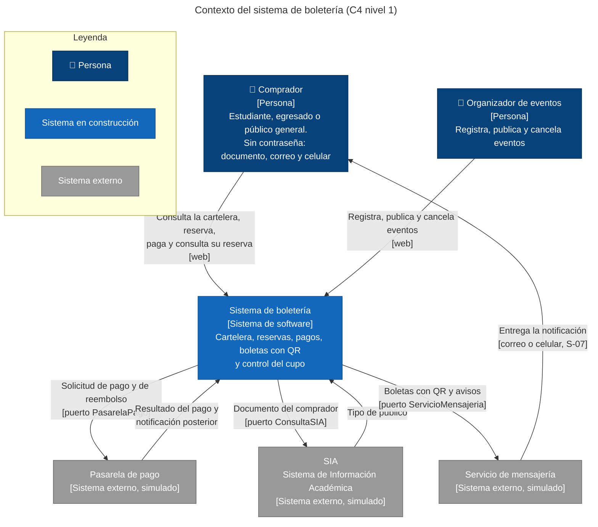

# Contexto del sistema de boletería

Autor: Sergio Velásquez (gerente de desarrollo) · Equipo LasPalomas · Fecha: 27/11/2026

Fuentes: el enunciado, [vision.md](vision.md), [drivers.md](drivers.md) y los ADR de [docs/adr/](adr/). Los nombres siguen los de los ADR y `drivers.md`; el glosario formal irá en `arquitectura.md`.

## 1. Diagrama de contexto (C4, nivel 1)

Las flechas indican quién inicia el intercambio. Los tres sistemas externos se usan en su versión simulada (S-06), según la definición del enunciado.

## 2. Catálogo de elementos

| Elemento | Tipo | Responsabilidad | Qué intercambia con el sistema | Fuente |
|---|---|---|---|---|
| Comprador | Persona | Consulta eventos, compra boletas y las recibe | **Envía:** documento, correo, celular, evento, localidad, cantidad (1 a 4), orden de pago. **Recibe:** cartelera con cupo, precio con descuento o aviso de tarifa general (S-05), estado de la reserva y del pago | Enunciado (actor); RN-04 |
| Organizador de eventos | Persona | Gestiona los eventos y sus localidades | **Envía:** nombre, fecha, hora de inicio, lugar, localidades (aforo y precio en COP), órdenes de publicar y cancelar. **Recibe:** el evento con su estado | Enunciado (actor); RN-01, RN-02, RN-10; acceso según S-03 |
| Sistema de boletería | Sistema en construcción | Aplica las reglas de negocio RN-01 a RN-11: cupo, reservas, pagos, tarifas, boletas, cancelación y cierre de la venta | — | Enunciado |
| Pasarela de pago | Sistema externo | Cobra, notifica el resultado y reembolsa | **Recibe:** solicitud de pago (reserva, monto en COP) y solicitud de reembolso (referencia del pago, monto). **Envía:** resultado aprobado, rechazado o pendiente, con su referencia; notificación posterior de un pago pendiente | Enunciado (actor); RN-06, RN-07, RN-10; [ADR-005](adr/ADR-005-integracion-pasarelas-mensajeria.md) |
| SIA | Sistema externo | Indica el tipo de público de un documento | **Recibe:** número de documento. **Envía:** estudiante, egresado, ambos o ninguno (S-04); puede no responder (S-05) | Enunciado (actor); RN-09; [ADR-005](adr/ADR-005-integracion-pasarelas-mensajeria.md) |
| Servicio de mensajería | Sistema externo | Entrega las notificaciones al comprador | **Recibe:** boletas con código y QR, aviso de reembolso, aviso de cancelación del evento. **Entrega** al comprador por correo o celular (S-07); el simulado escribe en consola o archivo | Enunciado (actor); RN-07, RN-08, RN-10; [ADR-005](adr/ADR-005-integracion-pasarelas-mensajeria.md) |

El tiempo no aparece como sistema externo: es un puerto interno (Reloj) con un adaptador del sistema y uno controlable ([ADR-007](adr/ADR-007-reloj-como-puerto.md)). La base de datos tampoco: es parte del sistema ([ADR-004](adr/ADR-004-base-de-datos.md)).

## 3. Justificación

| Decisión del diagrama | Drivers | ADR |
|---|---|---|
| Solo dos personas y tres sistemas externos: los actores del enunciado, sin agregar otros | Enunciado (actores); [vision.md](vision.md) sección 4 | — |
| Cada sistema externo se conecta por un puerto propio, con adaptadores simulados intercambiables | OB-03, RT-05, EAC-01, EAC-02, S-06 | [ADR-001](adr/ADR-001-estilo-arquitectonico.md), [ADR-005](adr/ADR-005-integracion-pasarelas-mensajeria.md) |
| La pasarela inicia un intercambio (notificación posterior), no solo responde | RN-06, RN-07, EAC-05, PA-03 | [ADR-005](adr/ADR-005-integracion-pasarelas-mensajeria.md) |
| El SIA puede no responder y la compra sigue | RN-09, EAC-06, S-05 | [ADR-005](adr/ADR-005-integracion-pasarelas-mensajeria.md) |
| Comprador y organizador usan una interfaz web con pantallas | RT-06 | [ADR-003](adr/ADR-003-frontend.md) |
| El comprador no tiene contraseña | RN-04, PA-05, S-10 | — |

## 4. Comportamiento

Secuencias que recorren este contexto: compra de punta a punta (CU-05, CU-06, CU-07, CU-08), pago pendiente con confirmación tardía (CU-07, CU-10) y cancelación de un evento (CU-04). **Pendiente Iteración 1.**
