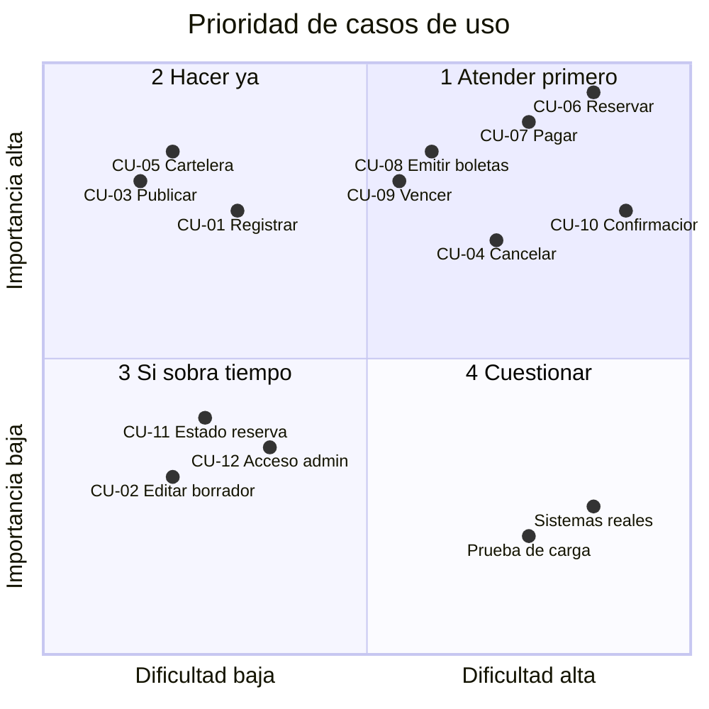
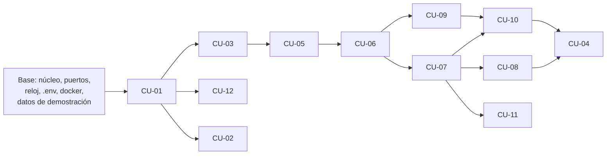

# Drivers de arquitectura: sistema de boletería para los eventos culturales de la universidad

Autor: Sergio Velásquez (gerente de desarrollo) · Equipo LasPalomas · Fecha: 27/11/2026 · Estado: borrador para revisión

Fuentes: el enunciado oficial y [vision.md](vision.md). Los objetivos (OB), restricciones (RT), supuestos (S) y riesgos (R) se citan con los ID de `vision.md`.

> **Importancia: propuesta del equipo, pendiente de confirmar con el docente.** Toda valoración de importancia de este documento (casos de uso primarios en la sección 1 y cuadrantes en la sección 5) es una propuesta.

## 1. Casos de uso

### 1.1 Reglas de negocio de referencia

Las reglas se toman del enunciado sin cambios de fondo y se identifican para poder trazarlas.

| ID | Regla (resumen del enunciado) |
|---|---|
| RN-01 | Un evento tiene nombre, fecha, hora de inicio, lugar y una o varias localidades, cada una con aforo y precio propios en COP |
| RN-02 | El evento se registra en borrador; solo publicado aparece en la cartelera y admite reservas. Publicado, sus localidades no se modifican |
| RN-03 | Cupo disponible = aforo − boletas pagadas − boletas en reservas vigentes. Nunca se reserva ni se vende por encima de él |
| RN-04 | El comprador se identifica con documento, correo y celular, sin contraseña. Máximo 4 boletas por evento (reservas vigentes + pagadas) |
| RN-05 | Una reserva es de un evento y una localidad, con 1 a 4 boletas. Vence a los 10 minutos si el pago no se confirma, aunque esté pendiente, y libera el cupo |
| RN-06 | Pago aprobado, rechazado o pendiente. Si se rechaza, la reserva sigue vigente y se puede reintentar. Si está pendiente, no se puede volver a pagar la misma reserva |
| RN-07 | Confirmación tardía: con la reserva vencida, se confirma si hay cupo; si no lo hay, o llega después de la hora de inicio, se reembolsa y se notifica |
| RN-08 | Al confirmarse el pago se emite una boleta por cupo, con código único, aleatorio y no consecutivo, y su QR; el comprador la recibe por notificación |
| RN-09 | Tarifa según el SIA: 50 % estudiante, 30 % egresado, el mayor si es ambos; solo a una boleta por evento, la del propio comprador |
| RN-10 | Cancelar un evento: sale de la cartelera, se anulan las reservas vigentes, se reembolsan las boletas pagadas por el mismo medio y se notifica a cada comprador |
| RN-11 | Desde la hora de inicio no se aceptan reservas nuevas ni pagos para el evento |

### 1.2 Catálogo

| ID | Caso de uso | Actor | ¿Primario? | Justificación (de dónde se deduce) | Se especifica en |
|---|---|---|---|---|---|
| CU-01 | Registrar evento en borrador con sus localidades | Organizador | No | RN-01, RN-02. Base de todos los demás casos de uso | `specs/001-registrar-evento` (planeado) |
| CU-02 | Editar evento en borrador | Organizador | No | RN-02 y S-08: solo se bloquean las localidades al publicar | sin especificar |
| CU-03 | Publicar evento | Organizador | No | RN-02: sin publicación no hay cartelera ni reservas | `specs/003-publicar-evento` (planeado) |
| CU-04 | Cancelar evento | Organizador | **Sí** | RN-10, S-11. Anula reservas, reembolsa y notifica | sin especificar |
| CU-05 | Consultar cartelera | Comprador | No | RN-02: solo eventos publicados y no cancelados, con cupo por localidad (RN-03) | `specs/005-consultar-cartelera` (planeado) |
| CU-06 | Reservar boletas | Comprador (usa el SIA) | **Sí** | RN-03, RN-04, RN-05, RN-09, RN-11, S-05, S-10. Identifica al comprador, calcula la tarifa y aparta el cupo | `specs/006-reservar-boletas` (planeado) |
| CU-07 | Pagar reserva | Comprador (usa la pasarela) | **Sí** | RN-06, RN-11. Resultado aprobado, rechazado o pendiente | `specs/007-pagar-reserva` (planeado) |
| CU-08 | Emitir y enviar boletas con QR | Sistema, al confirmarse el pago (usa la mensajería) | **Sí** | RN-08 | sin especificar |
| CU-09 | Vencer reservas sin pago confirmado | Sistema, por el reloj | **Sí** | RN-05, RN-03: libera el cupo a los 10 minutos | sin especificar |
| CU-10 | Procesar la confirmación de la pasarela | Pasarela de pago | **Sí** | RN-06, RN-07, RN-11, S-11, S-12. Incluye la confirmación tardía y el reembolso automático | sin especificar |
| CU-11 | Consultar el estado de la reserva y del pago | Comprador | No | RN-06: el comprador debe esperar la respuesta de un pago pendiente, así que necesita verla | sin especificar |
| CU-12 | Acceder a la parte de administración | Organizador | No | S-03: hay al menos un organizador y el mecanismo de acceso se decide en un ADR | sin especificar |

*Los caminos `specs/NNN-...` marcados "planeado" corresponden a los casos de uso que se especifican en el paso 7 del plan de la semana 0 (CU-01, CU-03, CU-05, CU-06, CU-07). Aún no existen.*

### 1.3 Casos de uso primarios

Criterios: (1) importancia para el negocio, (2) complejidad técnica, (3) alta frecuencia, (4) riesgo, (5) atado a un atributo de calidad crítico.

| CU | (1) Importancia | (2) Complejidad | (3) Frecuencia | (4) Riesgo | (5) Atributo crítico |
|---|---|---|---|---|---|
| CU-06 Reservar boletas | Es el inicio de toda venta (OB-02) | Concurrencia sobre el cupo, límite de 4 por evento, tarifa con el SIA | La operación más repetida del comprador | R-03 sobreventa | Corrección funcional del cupo (EAC-03), OB-01 |
| CU-07 Pagar reserva | Sin pago no hay venta electrónica (OB-02) | Tres resultados, bloqueo del reintento con pago pendiente, cierre de la venta | Una o más veces por reserva (reintentos tras rechazo) | R-04 doble pago | Modificabilidad de la pasarela (EAC-01), OB-03 |
| CU-10 Procesar la confirmación | Decide si el comprador recibe boletas o su dinero | Llega fuera del flujo del comprador, con la reserva quizá vencida | Una por cada pago pendiente | R-04 confirmación tardía | Tolerancia a fallos (EAC-05), OB-01, OB-04 |
| CU-09 Vencer reservas | Sin vencimiento el cupo queda bloqueado (OB-04) | Depende del tiempo, que solo llega por el puerto Reloj (RT-04) | Continua: cada reserva no pagada | R-03, R-04 | Comprobabilidad con reloj controlable (EAC-04), OB-04 |
| CU-08 Emitir y enviar boletas | Es lo que el comprador recibe (OB-02) | Código aleatorio no consecutivo, imagen QR, envío por mensajería | Una por cada pago confirmado | R-05 contrato de la mensajería | Modificabilidad de la mensajería (EAC-02), seguridad del código (EAC-07), OB-03 |
| CU-04 Cancelar evento | Protege al comprador cuando el evento no se realiza | Reembolso masivo, anulación de reservas y notificación a cada comprador | Baja | Toca pasarela y mensajería a la vez (R-05) | Modificabilidad (EAC-01, EAC-02), consistencia (OB-01) |

CU-01, CU-03 y CU-05 son imprescindibles, pero no son primarios: son registro y consulta de datos sin concurrencia ni integración externa.

## 2. Escenarios de atributos de calidad

Atributos según ISO/IEC 25010. Las medidas que no salen del enunciado están marcadas como *propuesta del equipo*.

### EAC-01. Mantenibilidad (modificabilidad): cambiar la pasarela de pago

| Parte | Valor |
|---|---|
| Fuente | Universidad (decide cambiar de proveedor) |
| Estímulo | Se pide usar otra pasarela de pago |
| Artefacto | Adaptador de la pasarela, raíz de composición y `.env` |
| Entorno | En desarrollo, con el sistema en la versión v0.1 o posterior |
| Respuesta | Entre dos pasarelas ya implementadas se cambia solo editando una variable del `.env`. Para integrar una nueva se agrega un adaptador que implementa el puerto de pago |
| Medida | Cambio entre pasarelas existentes: **0 archivos de código** editados. Integración de una nueva: **0 archivos** del núcleo modificados en `git diff` |

**Escenario:** la universidad decide cambiar de pasarela; el equipo cambia la variable de la pasarela en el `.env`, reinicia y el pago funciona con la otra pasarela sin editar código. Al integrar una pasarela nueva, ningún archivo del dominio ni de los casos de uso aparece en el `git diff`.
**Traza:** OB-03, RT-05 · CU-07, CU-10, CU-04.

### EAC-02. Mantenibilidad (modificabilidad): cambiar el servicio de mensajería

| Parte | Valor |
|---|---|
| Fuente | Universidad |
| Estímulo | Se pide usar otro servicio de mensajería |
| Artefacto | Adaptador de mensajería, raíz de composición y `.env` |
| Entorno | En desarrollo, v1.0 |
| Respuesta | Las boletas con QR y los avisos de reembolso salen por el nuevo servicio |
| Medida | Cambio entre servicios existentes: **0 archivos de código** editados. Integración de uno nuevo: **0 archivos** del núcleo modificados en `git diff` |

**Escenario:** el equipo cambia la variable de mensajería en el `.env`; tras un pago aprobado, las boletas llegan por el otro servicio (en el simulado, a la consola o al archivo de registro), sin cambios en el núcleo.
**Traza:** OB-03, RT-05 · CU-08, CU-04, CU-10.

### EAC-03. Adecuación funcional (corrección funcional): integridad del cupo con reservas simultáneas

| Parte | Valor |
|---|---|
| Fuente | Varios compradores |
| Estímulo | K solicitudes de reserva simultáneas sobre una localidad con cupo disponible C, con K > C |
| Artefacto | Caso de uso de reserva y adaptador de persistencia |
| Entorno | Operación normal, evento publicado antes de su hora de inicio |
| Respuesta | Se aceptan reservas hasta agotar el cupo y se rechazan las demás con un mensaje de cupo agotado |
| Medida | Boletas reservadas + pagadas ≤ aforo en el **100 %** de las ejecuciones; **0** sobreventas. Parámetros de la prueba: C = 1, K = 10, repetida 5 veces (*propuesta del equipo*, ya que el enunciado no da cifra: S-02) |

**Escenario:** diez compradores piden al mismo tiempo el último cupo de una localidad; exactamente uno obtiene la reserva y nueve reciben "cupo agotado". La base de datos nunca muestra un cupo negativo.
**Traza:** OB-01, R-03, S-02 · CU-06, CU-10.

### EAC-04. Mantenibilidad (capacidad de ser probado): vencimiento y cierre con reloj controlable

| Parte | Valor |
|---|---|
| Fuente | Integrante del equipo que valida, o el docente en la demostración |
| Estímulo | Se adelanta el reloj controlable |
| Artefacto | Puerto Reloj, adaptador de reloj controlable y casos de uso de reserva, pago y vencimiento |
| Entorno | Demostración, con el reloj controlable elegido en el `.env` |
| Respuesta | La reserva vence y libera el cupo; a la hora de inicio se rechazan reservas y pagos |
| Medida | Reserva creada en t0: vigente en t0 + 9:59, vencida en t0 + 10:00 (límite inclusivo, *propuesta del equipo*). Reserva o pago en la hora de inicio: rechazado en el **100 %** de los intentos. La demostración no requiere esperas reales: ninguna prueba espera más de 1 minuto real (*propuesta del equipo*) |

**Escenario:** en la demostración se crea una reserva, se adelanta el reloj 10 minutos y la cartelera muestra el cupo liberado; luego se adelanta hasta la hora de inicio y el intento de reservar se rechaza, todo sin esperar.
**Traza:** OB-04, RT-04, S-14 · CU-09, CU-06, CU-07.

### EAC-05. Fiabilidad (tolerancia a fallos): pago pendiente y confirmación tardía

| Parte | Valor |
|---|---|
| Fuente | Pasarela de pago |
| Estímulo | La pasarela responde "pendiente" y confirma después de que la reserva venció |
| Artefacto | Casos de uso de pago y de confirmación; adaptador de la pasarela |
| Entorno | Operación normal, con la pasarela simulada configurada para responder "pendiente" |
| Respuesta | Mientras el pago está pendiente se impide pagar de nuevo. En la confirmación tardía: se confirma si hay cupo; se reembolsa y notifica si no lo hay, si ya pasó la hora de inicio, si el evento fue cancelado (S-11) o si el comprador superaría 4 boletas (S-12) |
| Medida | **0** reservas pagadas dos veces. **5 de 5** casos de confirmación tardía (con cupo, sin cupo, tras la hora de inicio, evento cancelado, más de 4 boletas) terminan en el resultado esperado |

**Escenario:** un pago queda pendiente, el comprador intenta pagar otra vez y el sistema lo impide; la reserva vence, otro comprador toma el cupo y luego la pasarela aprueba el primer pago: el sistema lo reembolsa y notifica al comprador.
**Traza:** OB-01, OB-04, R-04 · CU-07, CU-10.

### EAC-06. Compatibilidad (interoperabilidad): SIA no disponible

| Parte | Valor |
|---|---|
| Fuente | SIA |
| Estímulo | El SIA no responde o no encuentra el documento |
| Artefacto | Adaptador del SIA y caso de uso de reserva |
| Entorno | Operación normal, con el SIA simulado configurado para no responder |
| Respuesta | Se aplica la tarifa de público general y se avisa al comprador antes de pagar (S-05, provisional) |
| Medida | **100 %** de las reservas continúan sin error; el aviso aparece en la pantalla de pago en el **100 %** de los casos |

**Escenario:** un estudiante reserva mientras el SIA no responde; ve el precio completo y un aviso de que no se pudo verificar su tipo de público, y decide si paga.
**Traza:** OB-05, R-05, S-05 · CU-06.

### EAC-07. Seguridad (integridad): códigos de boleta no predecibles

| Parte | Valor |
|---|---|
| Fuente | Cualquier persona que intente falsificar una boleta |
| Estímulo | Conoce un código de boleta válido e intenta deducir otro |
| Artefacto | Generación de códigos en la emisión de boletas |
| Entorno | Operación normal |
| Respuesta | Cada código es único, aleatorio y no consecutivo (RN-08) |
| Medida | En 100 boletas emitidas (*propuesta del equipo*): **0** códigos duplicados y **0** pares de boletas emitidas seguidas con códigos consecutivos |

**Escenario:** tras emitir las boletas de demostración, una consulta sobre la tabla de boletas no encuentra duplicados ni códigos consecutivos.
**Traza:** OB-02 · CU-08.

## 3. Restricciones

Se copian de `vision.md` sin transformarlas; se añaden tipo, origen e impacto.

| ID | Restricción | Tipo | Origen | Impacto arquitectónico esperado |
|---|---|---|---|---|
| RT-01 | Estilo hexagonal o Clean Architecture, justificado en un ADR que compara ambos frente a los drivers; propuesto en la semana 0 y aceptado en la iteración 1. *Nota: el equipo propone arquitectura hexagonal en [ADR-001](adr/ADR-001-estilo-arquitectonico.md); las tecnologías se justifican en los ADR siguientes* | Técnica | Docente | Define la estructura de carpetas (núcleo, puertos, adaptadores) y la vista de desarrollo |
| RT-02 | El núcleo (dominio y casos de uso) no depende de frameworks, base de datos, web ni proveedores y se comunica solo por puertos: ningún archivo del núcleo importa un adaptador | Técnica | Docente | FastAPI, Pydantic y SQLAlchemy quedan en adaptadores ([ADR-002](adr/ADR-002-backend.md), [ADR-004](adr/ADR-004-base-de-datos.md)); se necesita una raíz de composición fuera del núcleo |
| RT-03 | Persistencia en base de datos relacional, justificada en el ADR de persistencia | Técnica | Docente | PostgreSQL ([ADR-004](adr/ADR-004-base-de-datos.md)); puertos de repositorio en el núcleo |
| RT-04 | El tiempo es un puerto, con reloj del sistema y reloj controlable | Técnica | Docente | Ningún caso de uso lee la hora del sistema directamente; dos adaptadores de reloj elegibles por `.env` |
| RT-05 | La pasarela de pago y el servicio de mensajería se cambian por configuración, sin editar código y sin que ningún archivo del núcleo cambie en el historial de Git | Técnica | Docente | Puertos de pago y de notificación; selección de adaptador por `.env` en la raíz de composición |
| RT-06 | Interfaz web con pantallas de administración y de usuario sobre el mismo núcleo; una API sola no basta | Técnica | Docente | Frontend Angular con módulos `admin/` y `comprador/` sobre una API REST ([ADR-003](adr/ADR-003-frontend.md)) |
| RT-07 | Cada elección tecnológica (backend, frontend, base de datos, integración con pasarelas, persistencia) se justifica en un ADR frente a los drivers | Proceso | Docente | ADR-001 a ADR-004 y los ADR de integración con pasarelas y de persistencia |
| RT-08 | SDD con agente de IA, cuatro archivos por caso de uso y revisión humana (ver `AGENTS.md`) | Proceso | Docente | `plan.md` cita los ADR y los puertos y adaptadores de la vista de desarrollo |
| RT-09 | Roles TSPi, tablero en GitHub Projects, pull requests revisados por alguien distinto del autor y actas de ceremonias | Proceso | Docente | La lista de verificación de PR incluye la regla de dependencia |
| RT-10 | Semana 0 hasta el 27/11/2026; iteración 1 del 28/11 al 04/12 (v0.1); iteración 2 del 05/12 al 11/12 (v1.0); la v1.0 debe existir un día antes de la sustentación | Plazo | Docente | Limita el alcance construido (sección 5.4) |
| RT-11 | Clean Code y SOLID, script de datos de demostración y README para instalar y ejecutar desde cero | Técnica | Docente | Puertos pequeños y separados (SOLID); `docker-compose` y script de datos con SIA simulado |

## 4. Preocupaciones arquitectónicas

| ID | Preocupación | Qué hay que decidir | Por qué importa aquí |
|---|---|---|---|
| PA-01 | Estructura general | Hexagonal frente a Clean Architecture; carpetas del núcleo, puertos y adaptadores; dónde vive la raíz de composición | Es la exigencia con más peso en la evaluación (RT-01, RT-02). Se decide en [ADR-001](adr/ADR-001-estilo-arquitectonico.md) |
| PA-02 | Concurrencia sobre el cupo | Bloqueo de filas, nivel de aislamiento o restricción en la base; cómo el caso de uso pide el cupo a la persistencia sin conocer SQL | Sin esto hay sobreventa, el problema que motiva el sistema (OB-01, EAC-03). Se decide en el ADR de persistencia |
| PA-03 | Fallas de integración con la pasarela: pago pendiente, confirmación tardía, reembolso | Forma del puerto de pago (respuesta síncrona o confirmación posterior), cómo llega la confirmación (llamada de la pasarela o consulta periódica), cómo se impide el doble pago | Es donde el sistema puede perder dinero o cupo (R-04, EAC-05). Se decide en el ADR del modelo de integración con las pasarelas |
| PA-04 | Configuración de adaptadores | Nombres de las variables del `.env`, cómo la raíz de composición elige pasarela, mensajería, SIA y reloj, y qué pasa si la variable falta | Hace verificable el cambio sin editar código (RT-05, EAC-01, EAC-02) |
| PA-05 | Identificación del comprador sin contraseña | Qué dato identifica al comprador (S-10), qué hacer si el mismo documento llega con otro correo o celular | Afecta el límite de 4 boletas (RN-04) y el descuento a una sola boleta (RN-09) |
| PA-06 | Comunicación entre Angular y la API | Contrato OpenAPI, formato de errores de negocio, CORS por `.env`, cómo se entrega la imagen QR | El frontend no debe contener reglas (ADR-003); los errores del núcleo deben llegar legibles al comprador |
| PA-07 | Disparo del vencimiento de reservas | Tarea periódica, evaluación al consultar el cupo o ambas; cómo se integra con el reloj controlable | El cupo debe liberarse a tiempo y demostrarse sin esperar (OB-04, EAC-04) |
| PA-08 | Acceso del organizador | Mecanismo mínimo para proteger la parte de administración (S-03) | Sin él cualquiera publica o cancela eventos |
| PA-09 | Generación del código de boleta y del QR | Fuente de aleatoriedad, unicidad garantizada en la base, dónde se genera la imagen (núcleo con puerto o adaptador) | RN-08 y EAC-07; la librería de QR no puede entrar al núcleo (RT-02) |

*Números de los ADR pendientes: el plan asigna ADR-005 a Sergio, ADR-006 a Mariana y ADR-007 a Bairon, pero no dice cuál es de persistencia, de integración con pasarelas o de configuración. [NECESITA ACLARACIÓN: ¿qué tema tiene cada uno de ADR-005, ADR-006 y ADR-007, y en qué ADR se decide el acceso del organizador (PA-08)?]*

## 5. Matriz de priorización

> Importancia: **propuesta del equipo, confirmar con el docente.** Dificultad: estimación del equipo.

### 5.1 Matriz

### 5.2 Todos los drivers por cuadrante

Las restricciones (RT) no se priorizan: aplican a todo. Los escenarios (EAC) y preocupaciones (PA) se ubican con el caso de uso que los valida o que necesita la decisión.

| Cuadrante | Casos de uso | Escenarios y preocupaciones que arrastran |
|---|---|---|
| **1 Atender primero** (importancia alta, dificultad alta) | CU-06, CU-07, CU-08, CU-09, CU-10, CU-04 | EAC-01, EAC-02, EAC-03, EAC-04, EAC-05, EAC-06, EAC-07; PA-02, PA-03, PA-04, PA-07, PA-09 |
| **2 Hacer ya** (importancia alta, dificultad baja) | CU-01, CU-03, CU-05 | PA-01, PA-05, PA-06 (se deciden en la semana 0 porque todo depende de ellas) |
| **3 Si sobra tiempo** (importancia baja, dificultad baja) | CU-11, CU-12, CU-02 | PA-08 |
| **4 Cuestionar** (importancia baja, dificultad alta) | — | Integración con pasarela, mensajería o SIA reales (fuera de alcance, S-06); prueba de carga con un número real de compradores (sin cifra, S-02) |

### 5.3 Orden del backlog según dependencias

| Orden | Ítem | Depende de | Horas (propuesta) | Acumulado |
|---|---|---|---|---|
| 1 | Base transversal (estructura, puertos, reloj, `.env`, docker, script de demostración) | ADR-001 a ADR-004 | 4 | 4 |
| 2 | CU-01 Registrar evento | Base | 6 | 10 |
| 3 | CU-03 Publicar evento | CU-01 | 2 | 12 |
| 4 | CU-05 Consultar cartelera | CU-03 | 3 | 15 |
| 5 | CU-06 Reservar boletas | CU-05 | 10 | 25 |
| 6 | CU-07 Pagar reserva (dos pasarelas) | CU-06 | 8 | 33 |
| 7 | CU-08 Emitir y enviar boletas | CU-07 | 6 | 39 |
| 8 | CU-09 Vencer reservas | CU-06 | 4 | 43 |
| 9 | CU-10 Procesar confirmación | CU-07, CU-09 | 8 | 51 |
| 10 | CU-04 Cancelar evento | CU-08, CU-10 | 8 | 59 |
| 11 | CU-12 Acceso del organizador | CU-01 | 4 | 63 |
| 12 | CU-11 Estado de la reserva | CU-07 | 3 | 66 |
| 13 | CU-02 Editar borrador | CU-01 | 3 | 69 |

Las horas incluyen spec, plan, tareas, implementación y validación de cada ítem. Son una propuesta para que la gerente de planeación las ajuste.

### 5.4 Capacidad y lo que no alcanza

Capacidad del equipo (3 personas): [NECESITA ACLARACIÓN: ¿la capacidad es de 21 h o de 33 h por iteración, y es del equipo completo o por persona?]. Con las horas propuestas de 5.3:

| Escenario | Horas totales (2 iteraciones) | Iteración 1 llega hasta | No alcanzan |
|---|---|---|---|
| 21 h por iteración, equipo completo | 42 | CU-05 (15 h); CU-06 ya no cabe | CU-09, CU-10, CU-04, CU-12, CU-11, CU-02. **Quedan fuera tres casos de uso primarios**: no se cumplen OB-04 ni las reglas RN-07 y RN-10 |
| 33 h por iteración, equipo completo | 66 | CU-07 (33 h), como sugiere el enunciado | CU-02, sin holgura para imprevistos |
| 21 o 33 h por persona (63 o 99 h por iteración) | 126 o 198 | Todo el orden 1 a 6 | Ninguno |

Con 21 h por iteración del equipo no caben los casos de uso primarios: hay que revisar las estimaciones o la capacidad antes de la planeación de la iteración 1. Todos los ítems, se construyan o no, quedan como issues en el tablero (RT-09).
