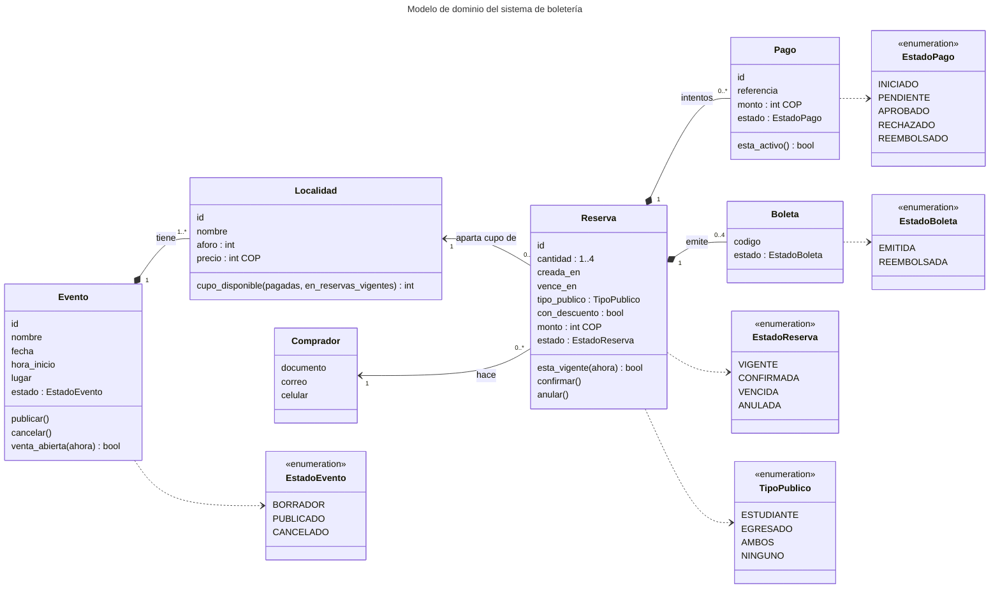
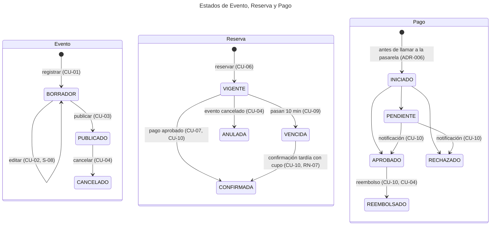

# Vista lógica: modelo de dominio

Autor: Sergio Velásquez (gerente de desarrollo) · Equipo LasPalomas · Fecha: 27/11/2026

Fuentes: reglas de negocio RN-01 a RN-11 de [drivers.md](../drivers.md), supuestos de [vision.md](../vision.md) y los ADR de [docs/adr/](../adr/). Esta vista describe el **dominio** (`src/backend/nucleo/dominio/`); no incluye adaptadores, base de datos ni API. Los nombres de atributos y métodos son los candidatos para el glosario de `arquitectura.md`.

## 1. Diagrama de clases

**Leyenda**

| Notación | Significado |
|---|---|
| `*--` (rombo lleno) | Composición: la parte no existe sin el todo (una localidad sin su evento, una boleta sin su reserva) |
| `<--` | Asociación navegable: la reserva conoce su localidad y su comprador |
| `..>` | Dependencia de un tipo enumerado |
| `<<enumeration>>` | Conjunto cerrado de valores |
| `"1"`, `"0..*"`, `"1..*"`, `"0..4"` | Multiplicidad |

## 2. Estados

**Leyenda:** `[*]` es el estado inicial; cada flecha indica el evento o caso de uso que produce la transición. La boleta pasa de `EMITIDA` a `REEMBOLSADA` cuando su pago se reembolsa (CU-04).

Notas:
- `VENCIDA` también se puede deducir sin guardarla: una reserva `VIGENTE` cuyo `vence_en` ya pasó según el Reloj no cuenta para el cupo. Cómo se persiste depende de la opción de vencimiento de [ADR-007](../adr/ADR-007-reloj-como-puerto.md) (V1, V2 o V3, pendiente).
- Un pago pasa de `APROBADO` a `REEMBOLSADO` en la confirmación tardía sin cupo, después de la hora de inicio, con el evento cancelado o si el comprador superaría 4 boletas (CU-10, RN-07, S-11, S-12), y al cancelar el evento (CU-04, RN-10).
- `INICIADO` viene de [ADR-006](../adr/ADR-006-persistencia.md) y está pendiente de confirmar. `REEMBOLSADO` refleja el reembolso por el mismo medio de pago (RN-07, RN-10).
- Un pago está **activo** si está `INICIADO`, `PENDIENTE` o `APROBADO` ([ADR-006](../adr/ADR-006-persistencia.md)).

## 3. Catálogo de elementos

| Elemento | Responsabilidad | Atributos clave | Fuente |
|---|---|---|---|
| `Evento` | Agrupa las localidades y controla su ciclo de vida y el cierre de la venta | nombre, fecha, hora de inicio, lugar, estado | RN-01, RN-02, RN-10, RN-11 |
| `Localidad` | Zona del escenario con aforo y precio propios; calcula su cupo disponible | aforo, precio en COP | RN-01, RN-03 |
| `Comprador` | Identifica a quien compra, sin contraseña | documento (identifica, S-10), correo, celular | RN-04 |
| `Reserva` | Aparta de 1 a 4 boletas de una localidad durante 10 minutos, con el monto calculado | cantidad, vence_en, tipo de público, con_descuento, monto, estado | RN-04, RN-05, RN-09 |
| `Pago` | Registra cada intento de pago de una reserva y su resultado en la pasarela | referencia, monto, estado | RN-06, RN-07; [ADR-005](../adr/ADR-005-integracion-pasarelas-mensajeria.md), [ADR-006](../adr/ADR-006-persistencia.md) |
| `Boleta` | Comprobante de un cupo pagado | código único, aleatorio y no consecutivo; estado | RN-08 |
| `TipoPublico` | Resultado de la consulta al SIA | estudiante, egresado, ambos, ninguno | RN-09, S-04 |

La imagen QR no es un atributo: se genera a partir del código de la boleta por el puerto `GeneradorQR` (PA-09, [vista de desarrollo](03-desarrollo.md)). Los montos son enteros en COP (S-13).

## 4. Reglas de negocio por entidad

| Regla | Entidad responsable | Cómo se expresa en el dominio | Quién más la respalda | RN |
|---|---|---|---|---|
| **Cupo disponible** = aforo − boletas pagadas − boletas en reservas vigentes; nunca se reserva por encima | `Localidad` | `cupo_disponible(...)`; la reserva se rechaza con una excepción de dominio si `cantidad > cupo` | El adaptador de persistencia bloquea la fila de la localidad antes de contar ([ADR-006](../adr/ADR-006-persistencia.md)). Las boletas pagadas se cuentan como la cantidad de las reservas `CONFIRMADA`, no como filas de `Boleta` | RN-03 |
| **Máximo 4 boletas por evento**, sumando reservas vigentes y boletas pagadas del mismo comprador | `Reserva` (1 a 4 por reserva) y caso de uso `ReservarBoletas` (suma del evento) | Invariante `1 <= cantidad <= 4`; el caso de uso suma lo que el comprador ya tiene en el evento | `CHECK` de 1 a 4 en la base y bloqueo de la fila del comprador ([ADR-006](../adr/ADR-006-persistencia.md)); también en la confirmación tardía (S-12) | RN-04, RN-05 |
| **10 minutos de reserva**, aunque el pago esté pendiente | `Reserva` | `vence_en = creada_en + 10 min`; `esta_vigente(ahora)` compara con la hora del puerto Reloj | El adaptador nunca usa la hora de la base ([ADR-006](../adr/ADR-006-persistencia.md), [ADR-007](../adr/ADR-007-reloj-como-puerto.md)) | RN-05 |
| **Descuento 50 % estudiante, 30 % egresado, el mayor si es ambos, a una sola boleta por evento** (la del propio comprador); las demás a precio completo | `Reserva` | Al crearla: si el comprador es estudiante o egresado y no tiene ya una boleta con descuento en el evento, `monto = precio × (1 − descuento) + precio × (cantidad − 1)`; si no, `precio × cantidad`. Redondeo al peso (S-13). Sin respuesta del SIA: tarifa general y aviso (S-05) | El puerto `ConsultaSIA` entrega el `TipoPublico` ([ADR-005](../adr/ADR-005-integracion-pasarelas-mensajeria.md)) | RN-09 |
| **Localidades inmutables tras publicar** | `Evento` | Solo en `BORRADOR` se agregan, quitan o cambian localidades; en otro estado, excepción de dominio | — | RN-02 |
| **Cierre de la venta a la hora de inicio** | `Evento` | `venta_abierta(ahora)` es falso desde la hora de inicio; reservar y pagar lo consultan | La confirmación tardía después de la hora de inicio se reembolsa (CU-10) | RN-11, RN-07 |
| Solo un evento **publicado** aparece en la cartelera y admite reservas | `Evento` | `estado == PUBLICADO` y venta abierta | — | RN-02 |
| **Sin doble pago**: no se paga una reserva con un pago activo | `Pago` / `Reserva` | `esta_activo()`; el caso de uso `PagarReserva` rechaza un nuevo intento si existe uno activo | Índice único parcial por reserva en la base ([ADR-006](../adr/ADR-006-persistencia.md)) | RN-06 |
| **Boleta por cupo, con código único, aleatorio y no consecutivo** | `Boleta` | Se emiten `cantidad` boletas al confirmarse la reserva | Código `UNIQUE` en la base ([ADR-006](../adr/ADR-006-persistencia.md)) | RN-08 |
| **Cancelación**: el evento sale de la cartelera, las reservas vigentes se anulan y las boletas pagadas se reembolsan | `Evento`, `Reserva`, `Boleta` | `Evento.cancelar()`, `Reserva.anular()`, boleta a `REEMBOLSADA` | `PasarelaPago.reembolsar` y `ServicioMensajeria` ([ADR-005](../adr/ADR-005-integracion-pasarelas-mensajeria.md)) | RN-10 |

## 5. Justificación

| Decisión del modelo | Drivers | ADR |
|---|---|---|
| Seis entidades, las que nombran las reglas del enunciado; sin entidades adicionales | RN-01 a RN-11 | — |
| `Pago` separado de `Reserva`, con varios intentos por reserva | RN-06 (reintento tras rechazo), RN-07, EAC-05 | [ADR-005](../adr/ADR-005-integracion-pasarelas-mensajeria.md), [ADR-006](../adr/ADR-006-persistencia.md) |
| Las reglas que dependen del tiempo reciben `ahora` como parámetro | RT-04, EAC-04, OB-04 | [ADR-007](../adr/ADR-007-reloj-como-puerto.md) |
| El cupo se calcula, no se guarda como contador | RN-03, EAC-03, PA-02 | [ADR-006](../adr/ADR-006-persistencia.md) |
| `Comprador` identificado por documento, sin credenciales | RN-04, S-10, PA-05 | — |
| Las entidades son clases de Python sin herencia del ORM ni de Pydantic | RT-02 | [ADR-001](../adr/ADR-001-estilo-arquitectonico.md), [ADR-002](../adr/ADR-002-backend.md), [ADR-006](../adr/ADR-006-persistencia.md) |
| `REEMBOLSADO` en el pago y `REEMBOLSADA` en la boleta | RN-07, RN-10, S-11, S-12 | [ADR-005](../adr/ADR-005-integracion-pasarelas-mensajeria.md) |

Pendientes que afectan esta vista:
- [NECESITA ACLARACIÓN: ¿se confirma el estado `INICIADO` del pago? Es el punto 3 pendiente del ADR-006.]
- [NECESITA ACLARACIÓN: ¿`VENCIDA` se guarda o se deduce de `vence_en`? Depende de la opción de vencimiento V1, V2 o V3 del ADR-007.]

## 6. Comportamiento

Secuencias que recorren esta vista: reservar con cupo y descuento (CU-06), pago aprobado, rechazado y pendiente (CU-07), confirmación tardía con y sin cupo (CU-10), vencimiento con reloj controlable (CU-09) y cancelación con reembolso (CU-04). **Pendiente Iteración 1.**
