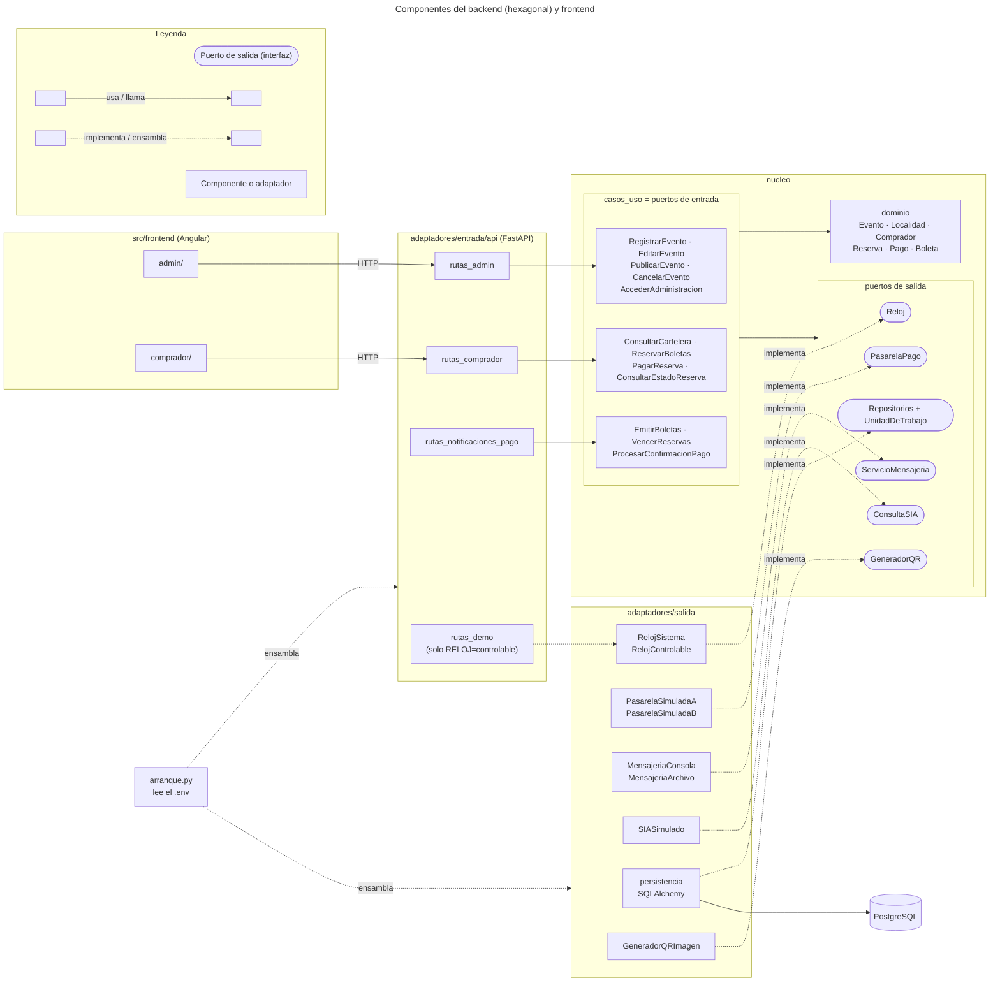

# Vista de desarrollo: estructura hexagonal

Autor: Sergio Velásquez (gerente de desarrollo) · Equipo LasPalomas · Fecha: 27/11/2026

Fuentes: [ADR-001](../adr/ADR-001-estilo-arquitectonico.md) (estilo hexagonal, propuesto), [ADR-002](../adr/ADR-002-backend.md) a [ADR-007](../adr/ADR-007-reloj-como-puerto.md), [drivers.md](../drivers.md) y la [vista lógica](01-logica.md). Esta vista fija los nombres que los ADR dejaron como ilustrativos (repositorios y archivos). Si ADR-001 cambia tras la clase de arquitectura hexagonal, esta vista se ajusta (R-09).

## 1. Árbol de `src/`

```text
src/
├── backend/
│   ├── nucleo/                         # NÚCLEO: no importa nada de adaptadores/ ni librerías externas
│   │   ├── dominio/                    # entidades y reglas (vista lógica)
│   │   │   ├── evento.py               # Evento, Localidad, EstadoEvento
│   │   │   ├── comprador.py            # Comprador, TipoPublico
│   │   │   ├── reserva.py              # Reserva, Boleta, EstadoReserva, EstadoBoleta
│   │   │   ├── pago.py                 # Pago, EstadoPago, SolicitudPago, ResultadoPago, ResultadoReembolso
│   │   │   ├── notificacion.py         # Notificacion
│   │   │   └── excepciones.py          # excepciones de dominio (estandares.md, sección 5)
│   │   ├── casos_uso/                  # PUERTOS DE ENTRADA: un archivo por caso de uso
│   │   │   ├── registrar_evento.py     # CU-01
│   │   │   ├── editar_evento.py        # CU-02
│   │   │   ├── publicar_evento.py      # CU-03
│   │   │   ├── cancelar_evento.py      # CU-04
│   │   │   ├── consultar_cartelera.py  # CU-05
│   │   │   ├── reservar_boletas.py     # CU-06
│   │   │   ├── pagar_reserva.py        # CU-07
│   │   │   ├── emitir_boletas.py       # CU-08
│   │   │   ├── vencer_reservas.py      # CU-09
│   │   │   ├── procesar_confirmacion_pago.py  # CU-10
│   │   │   ├── consultar_estado_reserva.py    # CU-11
│   │   │   └── acceder_administracion.py      # CU-12
│   │   └── puertos/                    # PUERTOS DE SALIDA: interfaces que el núcleo necesita
│   │       ├── repositorios.py         # RepositorioEventos, RepositorioCompradores,
│   │       │                           # RepositorioReservas, RepositorioPagos, UnidadDeTrabajo
│   │       ├── pasarela_pago.py        # PasarelaPago
│   │       ├── servicio_mensajeria.py  # ServicioMensajeria
│   │       ├── consulta_sia.py         # ConsultaSIA
│   │       ├── reloj.py                # Reloj
│   │       └── generador_qr.py         # GeneradorQR
│   ├── adaptadores/
│   │   ├── entrada/
│   │   │   └── api/                    # FastAPI + Pydantic (ADR-002)
│   │   │       ├── rutas_admin.py      # CU-01 a CU-04, CU-12
│   │   │       ├── rutas_comprador.py  # CU-05, CU-06, CU-07, CU-11
│   │   │       ├── rutas_notificaciones_pago.py  # CU-10 (ADR-005)
│   │   │       ├── rutas_demo.py       # adelantar el RelojControlable; solo con RELOJ=controlable (ADR-007)
│   │   │       ├── esquemas.py         # modelos Pydantic de la API
│   │   │       └── errores.py          # excepción de dominio -> código HTTP
│   │   └── salida/
│   │       ├── persistencia/           # SQLAlchemy + Alembic (ADR-006)
│   │       │   ├── modelos.py
│   │       │   ├── mapeadores.py
│   │       │   ├── repositorios_sql.py
│   │       │   ├── unidad_trabajo.py
│   │       │   └── migraciones/
│   │       ├── pasarelas/              # PasarelaSimuladaA, PasarelaSimuladaB (ADR-005)
│   │       ├── mensajeria/             # MensajeriaConsola, MensajeriaArchivo (ADR-005)
│   │       ├── sia/                    # SIASimulado y datos/sia.json (ADR-005)
│   │       ├── reloj/                  # RelojSistema, RelojControlable (ADR-007)
│   │       └── qr/                     # GeneradorQRImagen, con la librería qrcode (ADR-002, PA-09)
│   ├── scripts/                        # script de datos de demostración (RT-11, ADR-006)
│   └── arranque.py                     # raíz de composición: lee el .env y conecta puertos y adaptadores
└── frontend/                           # Angular (ADR-003): cliente del adaptador de entrada
    └── src/app/
        ├── admin/                      # pantallas del organizador (carga diferida)
        ├── comprador/                  # pantallas del comprador (carga diferida)
        └── api/                        # cliente HTTP del contrato OpenAPI
```

Ubicaciones que esta vista fija:
- **`arranque.py`** va en `src/backend/arranque.py`, fuera de `nucleo/` y de `adaptadores/`. Con esto se resuelve el punto 3 pendiente del ADR-001 y el punto 2 del ADR-005.
- **`adaptadores/salida/qr/`** no estaba en la lista inicial de carpetas. Se agrega porque la imagen del QR (RN-08) necesita una librería, y esa librería no puede entrar al núcleo (RT-02, PA-09).
- **`rutas_demo.py`** es la opción "endpoint" del punto 5 del ADR-007, todavía pendiente. Si el equipo elige un script, el archivo sale de `api/` y pasa a `scripts/`.

## 2. Diagrama de componentes



Todas las flechas que cruzan la frontera del núcleo apuntan hacia él o hacia sus puertos: ningún componente del núcleo apunta a un adaptador.

## 3. Catálogo de elementos

### Puertos de entrada (casos de uso)

Siguiendo la opción propuesta en el punto 1 del ADR-001, los casos de uso **son** los puertos de entrada: no se definen interfaces aparte.

| Caso de uso | CU | Lo invoca | Puertos de salida que usa |
|---|---|---|---|
| `RegistrarEvento`, `EditarEvento`, `PublicarEvento` | CU-01, CU-02, CU-03 | `rutas_admin` | Repositorios, UnidadDeTrabajo |
| `CancelarEvento` | CU-04 | `rutas_admin` | Repositorios, UnidadDeTrabajo, PasarelaPago, ServicioMensajeria |
| `AccederAdministracion` | CU-12 | `rutas_admin` | Repositorios (mecanismo pendiente: S-03, PA-08) |
| `ConsultarCartelera` | CU-05 | `rutas_comprador` | Repositorios, Reloj |
| `ReservarBoletas` | CU-06 | `rutas_comprador` | Repositorios, UnidadDeTrabajo, ConsultaSIA, Reloj |
| `PagarReserva` | CU-07 | `rutas_comprador` | Repositorios, UnidadDeTrabajo, PasarelaPago, Reloj; invoca `EmitirBoletas` si el pago se aprueba |
| `ConsultarEstadoReserva` | CU-11 | `rutas_comprador` | Repositorios, Reloj |
| `EmitirBoletas` | CU-08 | `PagarReserva`, `ProcesarConfirmacionPago` | Repositorios, GeneradorQR, ServicioMensajeria |
| `VencerReservas` | CU-09 | Pendiente: opción V1, V2 o V3 del ADR-007 | Repositorios, UnidadDeTrabajo, Reloj |
| `ProcesarConfirmacionPago` | CU-10 | `rutas_notificaciones_pago` | Repositorios, UnidadDeTrabajo, PasarelaPago, ServicioMensajeria, Reloj |

### Puertos de salida y sus adaptadores

| Puerto | Responsabilidad | Adaptadores | Variable del `.env` | Driver / ADR |
|---|---|---|---|---|
| `RepositorioEventos` | Guardar y leer eventos con sus localidades; bloquear la localidad para reservar | `repositorios_sql` | `DATABASE_URL` | RT-03, PA-02, EAC-03 / [ADR-006](../adr/ADR-006-persistencia.md) |
| `RepositorioCompradores` | Guardar y leer compradores por documento; bloquear al comprador | `repositorios_sql` | `DATABASE_URL` | RN-04, S-10 / [ADR-006](../adr/ADR-006-persistencia.md) |
| `RepositorioReservas` | Guardar y leer reservas con sus boletas; contar las vigentes con la hora recibida | `repositorios_sql` | `DATABASE_URL` | RN-03, RN-05, RN-08 / [ADR-006](../adr/ADR-006-persistencia.md) |
| `RepositorioPagos` | Guardar intentos de pago; buscarlos por referencia | `repositorios_sql` | `DATABASE_URL` | RN-06, EAC-05 / [ADR-006](../adr/ADR-006-persistencia.md) |
| `UnidadDeTrabajo` | Frontera de la transacción | `unidad_trabajo` | `DATABASE_URL` | EAC-03, EAC-05 / [ADR-006](../adr/ADR-006-persistencia.md) |
| `PasarelaPago` | Iniciar pago, interpretar notificación, reembolsar | `PasarelaSimuladaA`, `PasarelaSimuladaB` | `PASARELA_PAGO` | OB-03, EAC-01 / [ADR-005](../adr/ADR-005-integracion-pasarelas-mensajeria.md) |
| `ServicioMensajeria` | Enviar boletas y avisos | `MensajeriaConsola`, `MensajeriaArchivo` | `MENSAJERIA` | OB-03, EAC-02 / [ADR-005](../adr/ADR-005-integracion-pasarelas-mensajeria.md) |
| `ConsultaSIA` | Tipo de público de un documento | `SIASimulado` | `SIA`, `SIA_DATOS` | RN-09, EAC-06 / [ADR-005](../adr/ADR-005-integracion-pasarelas-mensajeria.md) |
| `Reloj` | Instante actual en America/Bogota | `RelojSistema`, `RelojControlable` | `RELOJ` | RT-04, EAC-04, S-14 / [ADR-007](../adr/ADR-007-reloj-como-puerto.md) |
| `GeneradorQR` | Imagen QR a partir del código de una boleta | `GeneradorQRImagen` | — (un solo adaptador) | RN-08, PA-09, RT-02 / [ADR-002](../adr/ADR-002-backend.md) |

### Otros componentes

| Componente | Responsabilidad | Driver / ADR |
|---|---|---|
| `adaptadores/entrada/api` | Traduce HTTP a llamadas a los casos de uso y excepciones de dominio a códigos HTTP; inyección de dependencias de FastAPI solo aquí | RT-06 / [ADR-002](../adr/ADR-002-backend.md), [ADR-005](../adr/ADR-005-integracion-pasarelas-mensajeria.md), [estandares.md](../equipo/estandares.md) |
| `arranque.py` | Raíz de composición: lee el `.env`, valida los valores y conecta cada puerto con su adaptador; si una variable falta o es inválida, no arranca | RT-05, PA-04 / [ADR-005](../adr/ADR-005-integracion-pasarelas-mensajeria.md) |
| `scripts/` | Carga los datos de demostración por los mismos puertos que la API | RT-11 / [ADR-006](../adr/ADR-006-persistencia.md) |
| `frontend/` (`admin/`, `comprador/`, `api/`) | Pantallas de las dos partes; sin reglas de negocio; solo habla con la API | RT-06 / [ADR-003](../adr/ADR-003-frontend.md) |

## 4. Regla de dependencia verificable

| # | Regla | Cómo se verifica |
|---|---|---|
| D1 | Nada en `nucleo/` importa `adaptadores/`, `fastapi`, `pydantic`, `sqlalchemy`, `alembic`, `psycopg` ni librerías de proveedores o de QR (`qrcode`) | Comando 1: debe devolver vacío |
| D2 | Nada en `nucleo/` lee la hora del sistema (`datetime.now`, `datetime.utcnow`, `date.today`, `time.time`): el tiempo llega por el puerto `Reloj` | Comando 1: debe devolver vacío |
| D3 | `nucleo/dominio/` no importa `casos_uso/` ni `puertos/` | Comando 2: debe devolver vacío |
| D4 | `nucleo/puertos/` no importa `casos_uso/` | Comando 3: debe devolver vacío |
| D5 | `adaptadores/salida/` no importa `adaptadores/entrada/` | Comando 4: debe devolver vacío |
| D6 | Cambiar entre adaptadores existentes no cambia ningún archivo de código, y agregar un adaptador no cambia ningún archivo del núcleo | `git diff --name-only main -- src/backend/nucleo` vacío (EAC-01, EAC-02) |
| D7 | Angular no contiene reglas de negocio y solo usa la API | Revisión del PR (ítem 3.4 del [checklist](../equipo/checklist-revision.md)) |

```bash
# 1. D1 y D2: imports prohibidos y lectura de la hora en el núcleo
grep -rnE "^\s*(from|import)\s+[A-Za-z0-9_.]*(adaptadores|fastapi|pydantic|sqlalchemy|alembic|psycopg|qrcode)\b|datetime\.(now|utcnow)|date\.today|time\.time\(" src/backend/nucleo

# 2. D3: el dominio no depende de casos de uso ni de puertos
grep -rnE "^\s*(from|import)\s+[A-Za-z0-9_.]*(casos_uso|puertos)\b" src/backend/nucleo/dominio

# 3. D4: los puertos no dependen de los casos de uso
grep -rnE "^\s*(from|import)\s+[A-Za-z0-9_.]*casos_uso\b" src/backend/nucleo/puertos

# 4. D5: los adaptadores de salida no dependen del de entrada
grep -rnE "^\s*(from|import)\s+[A-Za-z0-9_.]*entrada\b" src/backend/adaptadores/salida
```

Si se integra un proveedor con su propia librería, su nombre se agrega al patrón del comando 1 en el mismo pull request. El comando 1 amplía el del [checklist de revisión](../equipo/checklist-revision.md), que no cubre `alembic`, `psycopg`, `qrcode` ni las otras formas de leer la hora.

## 5. Justificación

| Decisión de la vista | Drivers | ADR |
|---|---|---|
| Tres zonas (`nucleo/`, `adaptadores/entrada/`, `adaptadores/salida/`) con una sola frontera | RT-01, RT-02, PA-01, R-02 | [ADR-001](../adr/ADR-001-estilo-arquitectonico.md) |
| Un puerto por sistema externo y un adaptador por proveedor, elegido por `.env` | OB-03, RT-05, EAC-01, EAC-02, PA-04 | [ADR-005](../adr/ADR-005-integracion-pasarelas-mensajeria.md) |
| `Reloj` como puerto con dos adaptadores | RT-04, EAC-04, OB-04 | [ADR-007](../adr/ADR-007-reloj-como-puerto.md) |
| Repositorios y `UnidadDeTrabajo` como puertos; SQLAlchemy solo en `persistencia/` | RT-02, RT-03, PA-02, EAC-03, EAC-05 | [ADR-004](../adr/ADR-004-base-de-datos.md), [ADR-006](../adr/ADR-006-persistencia.md) |
| `GeneradorQR` como puerto | RN-08, PA-09, RT-02 | [ADR-002](../adr/ADR-002-backend.md) |
| Un archivo por caso de uso, con el ID del catálogo | RT-08 (una carpeta de `specs/` por caso de uso), trazabilidad | — |
| Angular como proceso aparte con `admin/` y `comprador/` | RT-06 | [ADR-003](../adr/ADR-003-frontend.md) |
| Excepciones de dominio traducidas a HTTP solo en `api/errores.py` | RT-02 | [ADR-002](../adr/ADR-002-backend.md), [estandares.md](../equipo/estandares.md) |

Pendientes que afectan esta vista:
- [NECESITA ACLARACIÓN: ¿quién dispara `VencerReservas` (CU-09)? Si se elige V2 o V3 del ADR-007, hace falta un adaptador de entrada para la tarea periódica, que todavía no está en el árbol.]
- [NECESITA ACLARACIÓN: ¿el reloj controlable se adelanta desde `rutas_demo.py` o desde un script? Es el punto 5 pendiente del ADR-007.]

## 6. Comportamiento

Secuencias que recorren esta vista: reservar boletas atravesando API → `ReservarBoletas` → `ConsultaSIA`, `Reloj` y repositorios (CU-06); pagar con las dos pasarelas (CU-07); confirmación por `rutas_notificaciones_pago` (CU-10); vencimiento con `RelojControlable` (CU-09). **Pendiente Iteración 1.**
