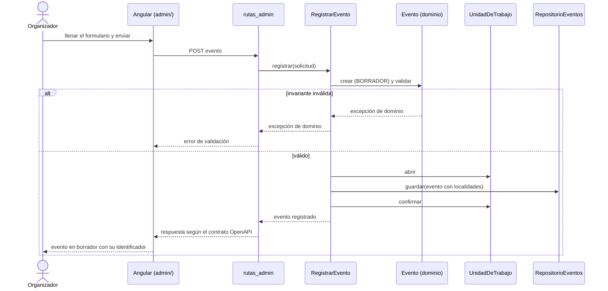

# Plan CU-01: Registrar evento en borrador con sus localidades

Autora: Mariana García · Aprueba frente a la arquitectura: Sergio Velásquez · Estado: borrador para revisión

Spec: [spec.md](spec.md). Este plan solo usa los ADR, puertos, adaptadores y archivos que ya fijan los ADR y la [vista de desarrollo](../../docs/vistas/03-desarrollo.md). Los nombres que no aparecen allí están marcados *propuesta* y los confirma Sergio al aprobar el plan.

## 1. ADR que aplica

| ADR | Qué aplica a este caso de uso |
|---|---|
| [ADR-001](../../docs/adr/ADR-001-estilo-arquitectonico.md) | El caso de uso es el puerto de entrada; el núcleo no importa adaptadores |
| [ADR-002](../../docs/adr/ADR-002-backend.md) | La ruta usa FastAPI y Pydantic solo en el adaptador de entrada; las reglas viven en el dominio |
| [ADR-003](../../docs/adr/ADR-003-frontend.md) | La pantalla vive en `admin/` y no contiene reglas: muestra los errores que devuelve la API |
| [ADR-004](../../docs/adr/ADR-004-base-de-datos.md) | Los datos se guardan en PostgreSQL |
| [ADR-006](../../docs/adr/ADR-006-persistencia.md) | El evento y sus localidades se guardan en una sola unidad de trabajo, con mapeo explícito entre dominio y modelos. Esta operación no toma bloqueos: crea filas nuevas |

## 2. Puertos y adaptadores que toca

| Componente | Archivo | Papel |
|---|---|---|
| Caso de uso `RegistrarEvento` | `nucleo/casos_uso/registrar_evento.py` | Orquesta el registro |
| Dominio `Evento`, `Localidad`, `EstadoEvento` | `nucleo/dominio/evento.py` | Crear el evento en `BORRADOR` y comprobar sus invariantes |
| Excepciones de dominio | `nucleo/dominio/excepciones.py` | Error de validación al registrar (*propuesta de nombre*) |
| Puerto `RepositorioEventos` | `nucleo/puertos/repositorios.py` | Guardar un evento con sus localidades |
| Puerto `UnidadDeTrabajo` | `nucleo/puertos/repositorios.py` | Confirma o revierte el guardado completo |
| Adaptador de persistencia | `adaptadores/salida/persistencia/modelos.py`, `mapeadores.py`, `repositorios_sql.py`, `unidad_trabajo.py`, `migraciones/` | Tablas de evento y localidad, mapeo explícito, repositorio y migración |
| Adaptador de entrada | `adaptadores/entrada/api/rutas_admin.py`, `esquemas.py`, `errores.py` | Endpoint de registro, esquemas Pydantic y traducción del error a HTTP |
| Frontend | `src/frontend/src/app/admin/` y `api/` | Formulario de registro y cliente del contrato OpenAPI |

No se crean puertos ni adaptadores nuevos. CU-01 **no usa** el puerto `Reloj` (spec P-02).

## 3. Diseño

**Dominio.** `Evento` se crea con sus datos y su lista de `Localidad`, siempre en `EstadoEvento.BORRADOR`. Las invariantes se comprueban en el dominio, no en la API ni en Angular (spec CU01-E04 a E08):

- nombre, fecha, hora de inicio y lugar presentes;
- al menos una localidad;
- cada localidad con nombre, aforo entero mayor que 0 y precio entero mayor que 0 (spec P-01);
- sin nombres de localidad repetidos (spec P-03).

Si una invariante falla, se lanza una excepción de dominio y no se guarda nada.

**Entrada y salida del caso de uso** (*propuesta*): una solicitud y una respuesta como `dataclass` simples del núcleo, no modelos de Pydantic ([AGENTS.md](../../AGENTS.md), [ADR-002](../../docs/adr/ADR-002-backend.md)). La respuesta lleva el identificador, los datos del evento, su estado y sus localidades.

**Persistencia.** `RepositorioEventos` recibe el `Evento` y lo guarda con sus localidades dentro de la `UnidadDeTrabajo`: el caso de uso confirma una sola vez al final, de modo que un fallo no deja un evento sin sus localidades (spec CU01-E06). La migración crea las tablas de evento y localidad. Las restricciones de la base respaldan lo que se puede expresar (*propuesta*): aforo y precio mayores que 0 y nombre de localidad único por evento.

## 4. API

- Endpoint de registro en `rutas_admin.py`. La ruta exacta se fija en el contrato OpenAPI (*propuesta*: `POST /eventos`).
- La solicitud declara su esquema en `esquemas.py`: nombre, fecha, hora de inicio, lugar y lista de localidades (nombre, aforo, precio entero). La respuesta devuelve el identificador, los datos, el estado y las localidades.
- Pydantic valida solo el formato (campos faltantes y tipos); las reglas de negocio las valida el dominio ([estandares.md](../../docs/equipo/estandares.md), sección 5).
- **Errores** (*propuesta*; la tabla se confirma al aprobar el plan): la excepción de validación del dominio se traduce a **422** en `errores.py`, con el dato que falla y sin trazas internas. Un campo faltante o de tipo incorrecto también se responde 422.

## 5. Frontend

Formulario en `admin/` para registrar el evento: sus cuatro datos y una lista de localidades a la que se pueden agregar y quitar filas. Muestra el evento registrado con su identificador (spec P-05) y los errores que devuelve la API, sin reinterpretarlos. No contiene reglas de negocio: no comprueba aforos ni precios por su cuenta (checklist 3.4).

## 6. Dependencias

| Depende de | Motivo |
|---|---|
| TEC-01 | Estructura y puertos del núcleo |
| TEC-02 | Raíz de composición que conecta la persistencia |
| TEC-04 | Persistencia en PostgreSQL y Alembic |
| TEC-05, TEC-06 | Esqueletos de la API y de Angular |
| TEC-07 | Datos de demostración y organizador para validar |

## 7. Verificación

- Regla de dependencia: los comandos de la sección 4 de la [vista de desarrollo](../../docs/vistas/03-desarrollo.md) devuelven vacío; en particular, nada de `sqlalchemy` ni `pydantic` en `nucleo/`.
- Los escenarios de [spec.md](spec.md) se validan uno por uno en [validacion.md](validacion.md). CU01-E09 exige reiniciar el backend y consultar la base.

## Revisión frente a la arquitectura

Revisor: gerente de desarrollo (Sergio Velásquez) · Fecha: 27/11/2026 · Lista de criterios: [vista de desarrollo](../../docs/vistas/03-desarrollo.md), ADR y [checklist](../../docs/equipo/checklist-revision.md), grupo 3.

| Criterio | Resultado |
|---|---|
| Cita los ADR que aplican | Sí (001, 002, 003, 004, 006) |
| Solo usa puertos, adaptadores y archivos de la vista de desarrollo; lo nuevo está marcado *propuesta* | Sí |
| Respeta la regla de dependencia (Pydantic, SQLAlchemy y FastAPI fuera del núcleo; DTO como `dataclass`) | Sí |
| El tiempo llega por el puerto `Reloj` o el plan justifica no usarlo | No lo usa; justificado (spec P-02) |
| Errores: excepciones de dominio traducidas a HTTP solo en `errores.py` | Sí: validación del dominio → 422, igual que CU-06 |
| El frontend no contiene reglas de negocio | Sí |
| Respeta el orden de bloqueos del ADR-006 | No aplica: crea filas nuevas |

**Observaciones:**

| ID | Observación |
|---|---|
| O-01 | Las restricciones propuestas en la base (aforo y precio mayores que 0, nombre de localidad único por evento) son coherentes con el ADR-006: la base respalda lo que se puede expresar. El nombre único por evento sale de un supuesto de la spec (P-03), no del enunciado. |
| O-02 | Falta TEC-03 en dependencias solo si más adelante se valida la fecha con el Reloj; hoy no aplica. |

**Dictamen propuesto:** **aprobar** sin cambios obligatorios.

**Aprobación:** pendiente de la firma de Sergio Velásquez. [NECESITA ACLARACIÓN: el enunciado exige revisión humana; Sergio debe confirmar o corregir este dictamen y firmar aquí, o aprobar en el pull request]
