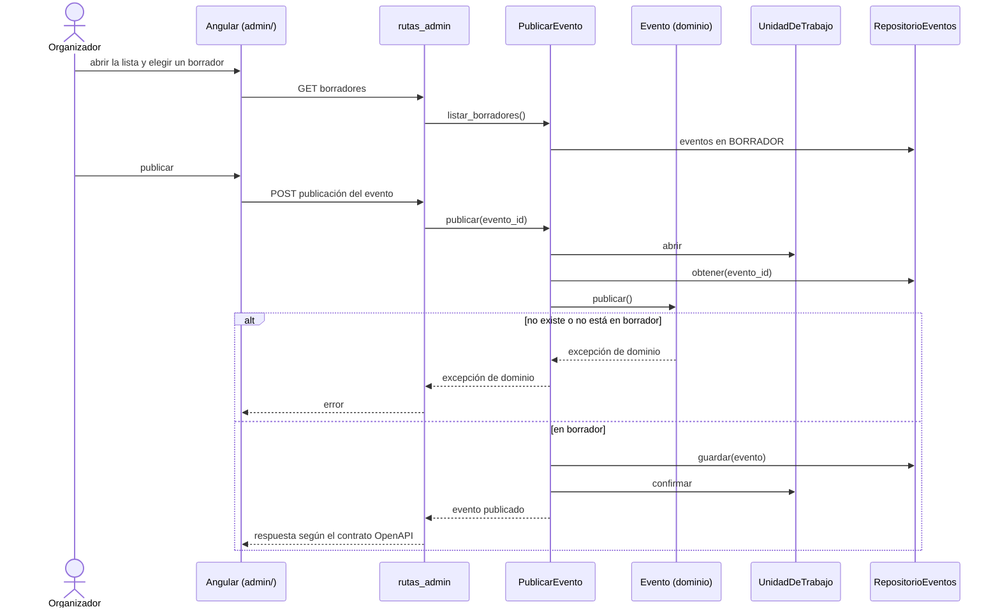

# Plan CU-03: Publicar evento

Autora: Mariana García · Aprueba frente a la arquitectura: Sergio Velásquez · Estado: borrador para revisión

Spec: [spec.md](spec.md). Este plan solo usa los ADR, puertos, adaptadores y archivos que ya fijan los ADR y la [vista de desarrollo](../../docs/vistas/03-desarrollo.md). Los nombres que no aparecen allí están marcados *propuesta* y los confirma Sergio al aprobar el plan.

## 1. ADR que aplica

| ADR | Qué aplica a este caso de uso |
|---|---|
| [ADR-001](../../docs/adr/ADR-001-estilo-arquitectonico.md) | El caso de uso es el puerto de entrada; el núcleo no importa adaptadores |
| [ADR-002](../../docs/adr/ADR-002-backend.md) | La ruta usa FastAPI y Pydantic solo en el adaptador de entrada; la regla de estado vive en el dominio |
| [ADR-003](../../docs/adr/ADR-003-frontend.md) | La pantalla vive en `admin/` y no contiene reglas: muestra los errores que devuelve la API |
| [ADR-006](../../docs/adr/ADR-006-persistencia.md) | El cambio de estado se guarda en una unidad de trabajo, con mapeo explícito. No toma bloqueos de cupo; el bloqueo del evento frente a CU-02 está pendiente (spec P-04) |

## 2. Puertos y adaptadores que toca

| Componente | Archivo | Papel |
|---|---|---|
| Caso de uso `PublicarEvento` | `nucleo/casos_uso/publicar_evento.py` | Orquesta la publicación y la lista de borradores |
| Dominio `Evento`, `EstadoEvento` | `nucleo/dominio/evento.py` | `Evento.publicar()` ya definido en la vista lógica: pasa de `BORRADOR` a `PUBLICADO`; las localidades quedan inmutables |
| Excepciones de dominio | `nucleo/dominio/excepciones.py` | Evento no encontrado y evento que no está en borrador (*propuesta de nombres*) |
| Puerto `RepositorioEventos` | `nucleo/puertos/repositorios.py` | Obtener un evento por identificador, guardar su estado y listar los borradores (*propuesta de métodos*) |
| Puerto `UnidadDeTrabajo` | `nucleo/puertos/repositorios.py` | Confirma o revierte el cambio |
| Adaptador de persistencia | `adaptadores/salida/persistencia/repositorios_sql.py`, `mapeadores.py` | Implementa los métodos nuevos del repositorio. **No hay migración nueva**: la columna de estado la crea la de CU-01 |
| Adaptador de entrada | `adaptadores/entrada/api/rutas_admin.py`, `esquemas.py`, `errores.py` | Endpoint de publicación, endpoint de la lista de borradores y traducción de errores a HTTP |
| Frontend | `src/frontend/src/app/admin/` y `api/` | Lista de borradores con la acción de publicar |

No se crean puertos ni adaptadores nuevos. CU-03 **no usa** el puerto `Reloj` (spec P-03).

## 3. Diseño

**Dominio.** `Evento.publicar()` comprueba su estado: solo desde `BORRADOR` pasa a `PUBLICADO`; desde cualquier otro estado lanza una excepción de dominio (spec CU03-E05 y E06). Comprueba también que tiene al menos una localidad. Una vez publicado, las operaciones que agregan, quitan o cambian localidades lanzan una excepción de dominio (spec CU03-E04): la regla ya está en la vista lógica ("localidades inmutables tras publicar").

**Pasos de `PublicarEvento`:**

1. Obtener el evento por identificador; si no existe, excepción de dominio (CU03-E07).
2. Llamar a `evento.publicar()`.
3. Guardar el evento en la unidad de trabajo y confirmar.
4. Devolver el evento publicado.

La lista de borradores (spec P-01) es una consulta de solo lectura al `RepositorioEventos`: devuelve los eventos en estado `BORRADOR`.

**Entrada y salida** (*propuesta*): solicitud y respuesta como `dataclass` simples del núcleo ([AGENTS.md](../../AGENTS.md)).

## 4. API

- Dos endpoints en `rutas_admin.py`. Las rutas exactas se fijan en el contrato OpenAPI (*propuesta*: `GET /eventos?estado=borrador` y `POST /eventos/{id}/publicacion`).
- Los esquemas de respuesta se declaran en `esquemas.py`: el evento con su identificador, datos, estado y localidades.
- **Errores** (*propuesta*; la tabla se confirma al aprobar el plan), traducidos en `errores.py`: evento no encontrado → **404**; evento que no está en borrador → **409**. Sin trazas internas.

## 5. Frontend

Pantalla en `admin/` con la lista de eventos en borrador y una acción de publicar por evento. Muestra los errores que devuelve la API y no los reinterpreta. No contiene reglas de negocio: no decide qué eventos se pueden publicar (checklist 3.4).

## 6. Dependencias

| Depende de | Motivo |
|---|---|
| CU-01 | Sin eventos en borrador no hay qué publicar; la columna de estado y las tablas vienen de su migración |
| TEC-01, TEC-04, TEC-05, TEC-06 | Estructura, persistencia y esqueletos de la API y de Angular |
| TEC-07 | Datos de demostración para validar |

CU03-E02 y CU03-E03 se validan cuando CU-05 y CU-06 existan, porque esas dos pantallas son quienes prueban el efecto de publicar.

## 7. Verificación

- Regla de dependencia: los comandos de la sección 4 de la [vista de desarrollo](../../docs/vistas/03-desarrollo.md) devuelven vacío; en particular, nada de `sqlalchemy` ni `pydantic` en `nucleo/`.
- Los escenarios de [spec.md](spec.md) se validan uno por uno en [validacion.md](validacion.md). CU03-E08 exige reiniciar el backend y consultar la base.
