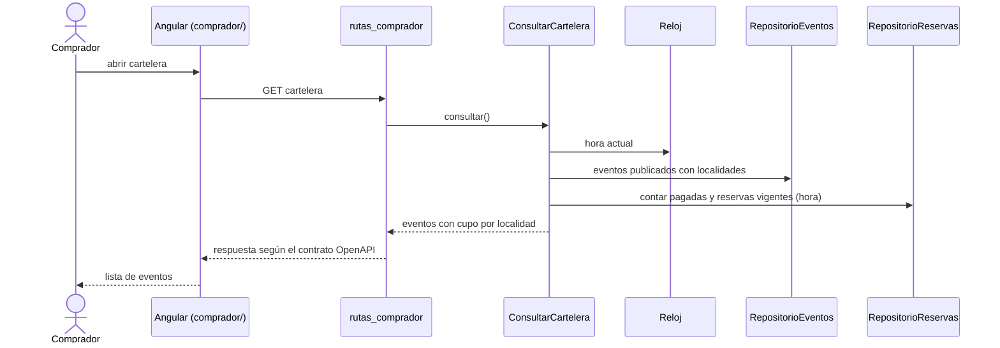

# Plan CU-05: Consultar cartelera

Autor: Bairon Vásquez · Aprueba frente a la arquitectura: Sergio Velásquez · Revisa: Mariana García · Estado: borrador para revisión

Spec: [spec.md](spec.md). Este plan solo usa los ADR, puertos, adaptadores y archivos que ya fijan los ADR y la [vista de desarrollo](../../docs/vistas/03-desarrollo.md). Los nombres de métodos que no aparecen allí están marcados *propuesta* y los confirma Sergio al aprobar el plan.

## 1. ADR que aplica

| ADR | Qué aplica a este caso de uso |
|---|---|
| [ADR-001](../../docs/adr/ADR-001-estilo-arquitectonico.md) | El caso de uso es el puerto de entrada; el núcleo no importa adaptadores |
| [ADR-002](../../docs/adr/ADR-002-backend.md) | La ruta usa FastAPI y Pydantic solo en el adaptador de entrada |
| [ADR-003](../../docs/adr/ADR-003-frontend.md) | La pantalla vive en `comprador/` y no contiene reglas: muestra el cupo que entrega la API |
| [ADR-006](../../docs/adr/ADR-006-persistencia.md) | El cupo se calcula, no se guarda; la vigencia usa la hora que recibe la consulta, nunca la de la base. Esta consulta no toma bloqueos |
| [ADR-007](../../docs/adr/ADR-007-reloj-como-puerto.md) | La hora sale del puerto Reloj, una sola vez por consulta |

## 2. Puertos y adaptadores que toca

| Componente | Archivo | Papel |
|---|---|---|
| Caso de uso `ConsultarCartelera` | `nucleo/casos_uso/consultar_cartelera.py` | Orquesta la consulta |
| Dominio `Evento`, `Localidad` | `nucleo/dominio/evento.py` | `Evento.venta_abierta(ahora)`, `Localidad.cupo_disponible(pagadas, en_reservas_vigentes)` ya definidos en la vista lógica |
| Puerto `Reloj` | `nucleo/puertos/reloj.py` | Hora actual |
| Puerto `RepositorioEventos` | `nucleo/puertos/repositorios.py` | Leer los eventos publicados con sus localidades |
| Puerto `RepositorioReservas` | `nucleo/puertos/repositorios.py` | Contar boletas pagadas y en reservas vigentes por localidad con la hora recibida |
| Adaptador de persistencia | `adaptadores/salida/persistencia/repositorios_sql.py` | Implementa los dos repositorios; sin bloqueos |
| Adaptador de entrada | `adaptadores/entrada/api/rutas_comprador.py`, `esquemas.py` | Endpoint de lectura y esquemas de respuesta |
| Frontend | `src/frontend/src/app/comprador/` y `api/` | Pantalla de cartelera y cliente del contrato OpenAPI |

No se crean puertos ni adaptadores nuevos.

## 3. Diseño

Métodos propuestos (*propuesta*):

- `RepositorioEventos`: obtener los eventos publicados con sus localidades.
- `RepositorioReservas`: contar, para un conjunto de localidades y una hora, las boletas pagadas y las boletas en reservas vigentes. Una sola consulta para todas las localidades, para no hacer una consulta por localidad.

Pasos de `ConsultarCartelera`:

1. Pedir la hora al Reloj.
2. Leer los eventos publicados.
3. Descartar los eventos con `venta_abierta(ahora)` falso (provisional, spec P-01).
4. Contar pagadas y reservas vigentes de todas sus localidades con esa hora.
5. Calcular `cupo_disponible` de cada localidad con la regla del dominio y devolver la lista, ordenada por fecha y hora de inicio (spec P-02).

## 4. API

- Endpoint de lectura de la cartelera. La ruta exacta se fija en el contrato OpenAPI (propuesta: `/cartelera`).
- La respuesta declara su esquema en `esquemas.py`: por evento, nombre, fecha, hora de inicio y lugar; por localidad, nombre, precio entero en COP y cupo disponible.
- No hay errores de negocio: una cartelera vacía es una respuesta válida con lista vacía.

## 5. Frontend

Pantalla de cartelera en `comprador/`: lista de eventos con sus localidades, precio y cupo, y un mensaje cuando la lista está vacía. Muestra el cupo que entrega la API y no calcula nada (checklist 3.4). La acción de reservar pertenece a CU-06.

## 6. Dependencias

| Depende de | Motivo |
|---|---|
| CU-03 | Sin eventos publicados no hay qué mostrar |
| TEC-03 | Puerto Reloj y sus dos adaptadores |
| TEC-04 | Persistencia y migraciones |
| TEC-05, TEC-06 | Esqueletos de la API y de Angular |
| TEC-07 | Datos de demostración para validar |

## 7. Verificación

- Regla de dependencia: los comandos de la sección 4 de la [vista de desarrollo](../../docs/vistas/03-desarrollo.md) devuelven vacío.
- Los escenarios de [spec.md](spec.md) se validan uno por uno en [validacion.md](validacion.md). CU05-E05 usa el reloj controlable.

## Revisión frente a la arquitectura

Revisor: gerente de desarrollo (Sergio Velásquez) · Fecha: 27/11/2026 · Lista de criterios: [vista de desarrollo](../../docs/vistas/03-desarrollo.md), ADR y [checklist](../../docs/equipo/checklist-revision.md), grupo 3.

| Criterio | Resultado |
|---|---|
| Cita los ADR que aplican | Sí (001, 002, 003, 006, 007) |
| Solo usa puertos, adaptadores y archivos de la vista de desarrollo; lo nuevo está marcado *propuesta* | Sí |
| Respeta la regla de dependencia (Pydantic, SQLAlchemy y FastAPI fuera del núcleo; DTO como `dataclass`) | Sí |
| El tiempo llega por el puerto `Reloj` o el plan justifica no usarlo | Sí, una vez por consulta |
| Errores: excepciones de dominio traducidas a HTTP solo en `errores.py` | No hay errores de negocio; lista vacía válida |
| El frontend no contiene reglas de negocio | Sí |
| Respeta el orden de bloqueos del ADR-006 | Sí: lectura sin bloqueos |

**Observaciones:**

| ID | Observación |
|---|---|
| O-01 | **Método compartido con CU-06.** El conteo de pagadas y reservas vigentes debe ser **un solo método** de `RepositorioReservas` para CU-05 y CU-06: `contar_boletas_ocupadas(localidad_ids, ahora)`, que recibe una o varias localidades y devuelve, por localidad, pagadas y en reservas vigentes. CU-06 lo llama con una sola localidad después de bloquearla. Así la cartelera y la reserva no pueden calcular el cupo de forma distinta. El plan de CU-06 ya se ajustó. |
| O-02 | El cupo cuenta como **boletas pagadas** la cantidad de las reservas `CONFIRMADA`, no las filas de `Boleta`. Así el cálculo funciona en la iteración 1, cuando CU-07 confirma reservas sin emitir boletas (CU-08 es de la iteración 2), y sigue igual después. |
| O-03 | Agregar TEC-01 y TEC-02 a las dependencias: la estructura y la raíz de composición que conecta el `Reloj` elegido en el `.env`. |

**Dictamen propuesto:** **aprobar con cambios menores** (O-01 y O-03 en el texto del plan; O-02 no cambia el diseño).

**Aprobación:** pendiente de la firma de Sergio Velásquez. [NECESITA ACLARACIÓN: el enunciado exige revisión humana; Sergio debe confirmar o corregir este dictamen y firmar aquí, o aprobar en el pull request]
