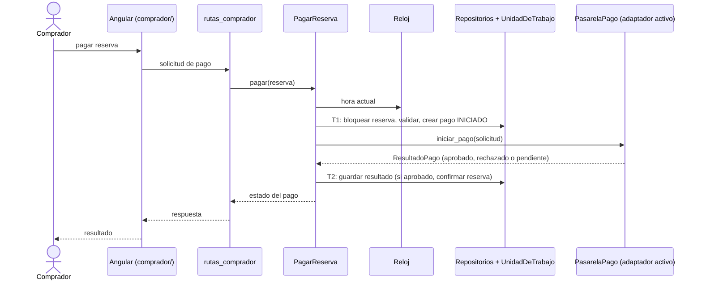

# Plan CU-07: Pagar reserva

Autor: Bairon Vásquez · Aprueba frente a la arquitectura: Sergio Velásquez · Revisa: Mariana García · Estado: borrador para revisión

Spec: [spec.md](spec.md). Este plan solo usa los ADR, puertos, adaptadores y archivos que ya fijan los ADR y la [vista de desarrollo](../../docs/vistas/03-desarrollo.md). Lo marcado *propuesta* lo confirma Sergio al aprobar el plan.

## 1. ADR que aplica

| ADR | Qué aplica a este caso de uso |
|---|---|
| [ADR-001](../../docs/adr/ADR-001-estilo-arquitectonico.md) | `PagarReserva` es el puerto de entrada; el núcleo no importa adaptadores |
| [ADR-002](../../docs/adr/ADR-002-backend.md) | FastAPI y Pydantic solo en `rutas_comprador` y `esquemas`; las excepciones de dominio se traducen a HTTP en `errores.py` |
| [ADR-003](../../docs/adr/ADR-003-frontend.md) | La pantalla en `comprador/` informa el resultado y no decide reglas |
| [ADR-005](../../docs/adr/ADR-005-integracion-pasarelas-mensajeria.md) | Puerto `PasarelaPago` con `iniciar_pago`; dos adaptadores simulados elegidos por `PASARELA_PAGO`; resultado `APROBADO`, `RECHAZADO` o `PENDIENTE` |
| [ADR-006](../../docs/adr/ADR-006-persistencia.md) | Dos transacciones cortas alrededor de la llamada a la pasarela; estado `INICIADO`; índice único parcial de pago activo por reserva; bloqueo de la reserva |
| [ADR-007](../../docs/adr/ADR-007-reloj-como-puerto.md) | La hora sale del puerto Reloj, una vez por operación |

## 2. Puertos y adaptadores que toca

| Componente | Archivo | Papel |
|---|---|---|
| Caso de uso `PagarReserva` | `nucleo/casos_uso/pagar_reserva.py` | Orquesta el pago |
| Dominio `Pago`, `Reserva`, `Evento` | `nucleo/dominio/pago.py`, `reserva.py`, `evento.py` | `Pago.esta_activo()`, `Reserva.esta_vigente(ahora)`, `Reserva.confirmar()`, `Evento.venta_abierta(ahora)` |
| Excepciones de dominio | `nucleo/dominio/excepciones.py` | Errores de la sección 4 |
| Puerto `PasarelaPago` | `nucleo/puertos/pasarela_pago.py` | `iniciar_pago(solicitud) -> ResultadoPago` |
| Puerto `Reloj` | `nucleo/puertos/reloj.py` | Hora actual |
| Puertos `RepositorioReservas`, `RepositorioPagos`, `UnidadDeTrabajo` | `nucleo/puertos/repositorios.py` | Leer y bloquear la reserva; guardar el intento y su resultado |
| Adaptadores de pasarela | `adaptadores/salida/pasarelas/` | `PasarelaSimuladaA` y `PasarelaSimuladaB`, con sus archivos de respuestas por documento |
| Adaptador de persistencia | `adaptadores/salida/persistencia/` | Repositorios, `unidad_trabajo`, modelo del pago y migración del índice único parcial |
| Raíz de composición | `src/backend/arranque.py` | Conecta `PasarelaPago` con el adaptador de `PASARELA_PAGO` |
| Adaptador de entrada | `adaptadores/entrada/api/rutas_comprador.py`, `esquemas.py`, `errores.py` | Endpoint de pago |
| Frontend | `src/frontend/src/app/comprador/` y `api/` | Pantalla de pago |

No se crean puertos ni adaptadores nuevos. Los puertos de mensajería y de QR no se usan en esta spec (CU-08 y CU-10).

## 3. Diseño

Pasos de `PagarReserva` (la hora se pide una sola vez):

1. **Hora:** `ahora` del Reloj.
2. **Transacción 1:** bloquear la reserva; comprobar que existe, que no está pagada, que sigue vigente con `ahora`, que la venta del evento está abierta con `ahora` y que no tiene un pago activo; crear el pago en `INICIADO` con el monto de la reserva; confirmar.
3. **Sin transacción:** `PasarelaPago.iniciar_pago(solicitud)`. No se sostiene ningún bloqueo mientras se espera a la pasarela.
4. **Transacción 2:** bloquear el pago; guardar su resultado y su referencia. Si es `APROBADO`, confirmar la reserva en la misma transacción. Con `RECHAZADO` o `PENDIENTE` la reserva sigue vigente.
5. Devolver el estado del pago.

Orden de bloqueos del ADR-006: comprador, localidad, reserva y pago. Este caso de uso toma solo reserva y luego pago, en ese orden.

Defensa en la base: el índice único parcial de pago activo por reserva rechaza un segundo intento aunque el código fallara; el adaptador lo traduce a la excepción de pago activo.

## 4. Errores de negocio y respuesta HTTP

Las excepciones viven en el dominio y las traduce `errores.py` ([estandares.md](../../docs/equipo/estandares.md)). Nombres y códigos son *propuesta*, que Sergio fija al aprobar el plan ([NECESITA ACLARACIÓN: ¿la lista de códigos la fija Sergio en `arquitectura.md` o cada plan? Pregunta abierta de `estandares.md`]).

| Situación | Excepción de dominio (*propuesta*) | HTTP (*propuesta*) | Escenario |
|---|---|---|---|
| La reserva no existe | `ReservaNoEncontrada` | 404 | CU07-E11 |
| La reserva venció | `ReservaVencida` | 409 | CU07-E06, E07 |
| La venta del evento está cerrada | `VentaCerrada` | 409 | CU07-E08 |
| Hay un pago pendiente o en curso | `PagoPendiente` | 409 | CU07-E05, E09 |
| La reserva ya está pagada | `ReservaYaPagada` | 409 | CU07-E10 |

Un pago **rechazado** no es un error: es una respuesta válida con el estado `RECHAZADO` y su motivo.

## 5. Adaptadores de pasarela

Las dos pasarelas implementan `iniciar_pago` con el mismo contrato y responden según el documento del comprador, con un archivo de respuestas propio. `PasarelaSimuladaA` genera referencias que empiezan por `A-` y `PasarelaSimuladaB` por `B-`. Al arrancar, cada una escribe en el registro `Pasarela activa: simulada_a` o `simulada_b`. Cambiar de una a otra es editar `PASARELA_PAGO` y reiniciar, sin tocar código (EAC-01, CU07-E12).

El script de datos (TEC-07) debe incluir compradores de prueba para los tres resultados y los mismos documentos en los archivos de respuestas de A y B.

## 6. Frontend

Pantalla de pago en `comprador/`: resumen de la reserva (monto y vencimiento) y botón para pagar. Muestra el resultado (aprobado, rechazado con su motivo, o pendiente con el aviso de esperar) y los errores de la sección 4 con el mensaje que devuelve la API. No calcula montos ni valida plazos (checklist 3.4).

## 7. Dependencias

| Depende de | Motivo |
|---|---|
| CU-06 | Sin reserva no hay qué pagar |
| TEC-02 | Selección de la pasarela por `.env` |
| TEC-03 | Puerto Reloj y reloj controlable para E06 a E08 |
| TEC-04 | Persistencia, transacciones y el índice único parcial |
| TEC-05, TEC-06 | Esqueletos de la API y de Angular |
| TEC-07 | Compradores de prueba y archivos de respuestas |

## 8. Verificación

- Regla de dependencia: los comandos de la sección 4 de la [vista de desarrollo](../../docs/vistas/03-desarrollo.md) devuelven vacío.
- EAC-01 (D6): `git diff --name-only HEAD` vacío tras cambiar la pasarela.
- Los escenarios de [spec.md](spec.md) se validan en [validacion.md](validacion.md). CU07-E06 a E08 usan el reloj controlable y CU07-E09 la concurrencia de EAC-05.

## Revisión frente a la arquitectura

Revisor: gerente de desarrollo (Sergio Velásquez) · Fecha: 27/11/2026 · Lista de criterios: [vista de desarrollo](../../docs/vistas/03-desarrollo.md), ADR y [checklist](../../docs/equipo/checklist-revision.md), grupo 3.

| Criterio | Resultado |
|---|---|
| Cita los ADR que aplican | Sí (001, 002, 003, 005, 006, 007) |
| Solo usa puertos, adaptadores y archivos de la vista de desarrollo; lo nuevo está marcado *propuesta* | Sí |
| Respeta la regla de dependencia (Pydantic, SQLAlchemy y FastAPI fuera del núcleo; DTO como `dataclass`) | Sí |
| El tiempo llega por el puerto `Reloj` o el plan justifica no usarlo | Sí, una vez por operación |
| Errores: excepciones de dominio traducidas a HTTP solo en `errores.py` | Sí: 404 y 409, con `VentaCerrada` compartida con CU-06 |
| El frontend no contiene reglas de negocio | Sí |
| Respeta el orden de bloqueos del ADR-006 | Sí: reserva y luego pago |

**Observaciones:**

| ID | Observación |
|---|---|
| O-01 | **Boletas en la iteración 1 (spec P-01).** El ADR-006 pide confirmar la reserva y emitir las boletas en la misma transacción. Recomendación: en la iteración 1, T2 confirma la reserva sin emitir boletas; cuando exista CU-08, `EmitirBoletas` se llama **dentro de esa misma T2**, sin cambiar el resto del diseño. La diferencia temporal se registra como deuda técnica en [arquitectura.md](../../docs/arquitectura.md), sección 9. La otra opción, adelantar CU-08 a la iteración 1, es decisión de la planeación (acta, riesgo nuevo). |
| O-02 | El cupo cuenta como **boletas pagadas** la cantidad de las reservas `CONFIRMADA`, no las filas de `Boleta`. Así el cálculo funciona en la iteración 1, cuando CU-07 confirma reservas sin emitir boletas (CU-08 es de la iteración 2), y sigue igual después (ver O-02 de CU-05). |
| O-03 | Si la reserva vence mientras se espera a la pasarela, T2 usa la `ahora` tomada al inicio, así que el pago aprobado confirma la reserva: el plazo se evalúa al momento de la solicitud. Con las pasarelas simuladas la espera es inmediata; se acepta y se documenta en el plan. |
| O-04 | Agregar TEC-01 a las dependencias. |

**Dictamen propuesto:** **aprobar con cambios menores**; O-01 necesita una decisión del equipo antes de implementar T-07-02.

**Aprobación:** pendiente de la firma de Sergio Velásquez. [NECESITA ACLARACIÓN: el enunciado exige revisión humana; Sergio debe confirmar o corregir este dictamen y firmar aquí, o aprobar en el pull request]
